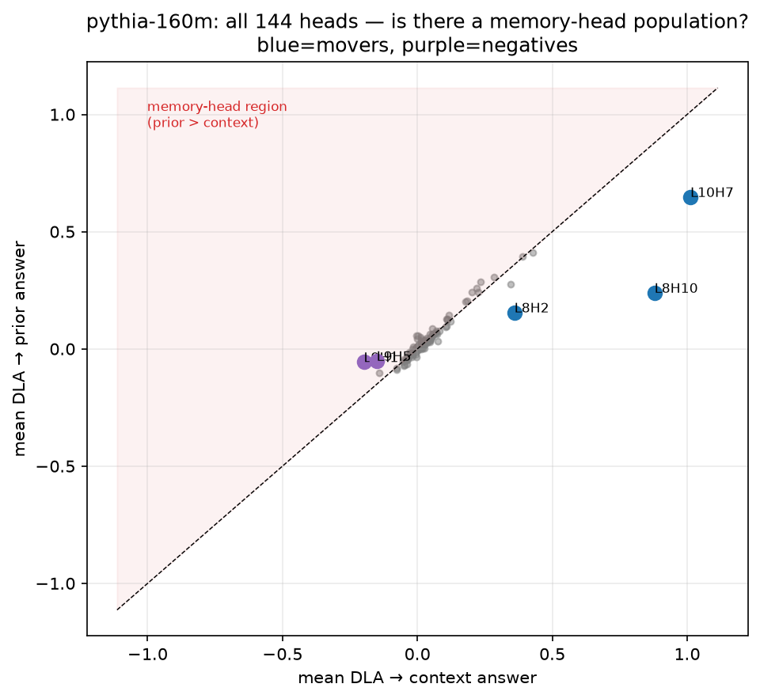
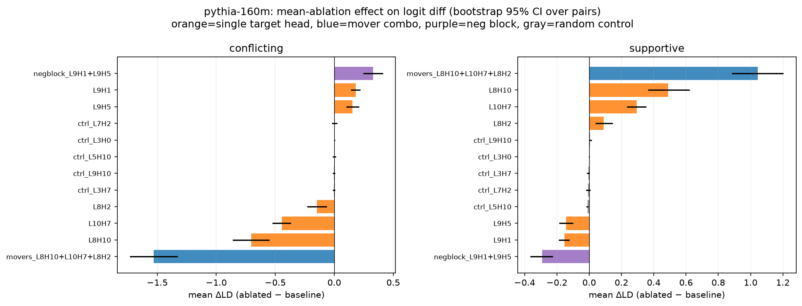

# rag-override-circuits

**Context faithfulness in small language models is a sparse, prior-invariant
attention circuit; parametric resistance is not head-localized at 124M–160M,
and has no functional counterpart to the billion-scale "memory head" motif.**

A mechanistic-interpretability study of how GPT-2-small (124M) and Pythia-160M
decide, token by token, whether to trust retrieved context or fall back on
parametric memory when the two conflict. It is a **controlled replication and
scale-boundary refinement** of Jin et al. 2024 ("Cutting Off the Head Ends the
Conflict", PH3; [arXiv:2402.18154](https://arxiv.org/abs/2402.18154)), which
localizes opposing *context* and *memory* heads at 1.3B–13B. We test whether
that two-population picture holds two orders of magnitude smaller.

The write-up is in [`paper/main.tex`](paper/main.tex).

## Findings

Stated at the confidence the data supports — including where it splits between
models and where a hypothesis was refuted.

**1. A sparse context "mover" circuit (both models, four methods, metric-robust).**
Context faithfulness is carried by 2–3 late attention heads — GPT-2 `L9H9`,
`L10H2`; Pythia `L8H10`, `L10H7`, `L8H2` — that attend to the retrieved number
and copy it into the answer. Mean-ablating them collapses context-following
(GPT-2 0.97 → 0.27; Pythia 0.75 → 0.09; random-head controls at the noise
floor). Direct logit attribution and OV-circuit copy scores confirm the
mechanism. The circuit is invariant to how strongly the prior is held. It is
robust to metric choice: under **PH3's own importance metric** these are the
top-ranked *context* heads in both models.



**2. No functional memory heads at this scale (a scale boundary + a methods caution).**
No head writes the parametric answer or scales its effect with prior strength.
A scan over all 144 heads leaves the memory-head region empty (above; strongest
prior-leaning head +0.14 vs. mover context-lean −0.64). PH3's importance metric
*does* return a memory-side top-5% here — but those heads are, mechanistically,
reactive context-**dampeners** that suppress *both* answers, not memory heads.
Importance scores alone can mislabel suppression heads as memory heads;
functional tests are needed to tell them apart.



**3. Resistance is diffuse — pre-registered, and it splits by model.**
Parametric resistance appears not in a head but as a lean spread across the
non-mover attention layer that tracks prior strength. This was found post-hoc
in one phase, so it was **pre-registered** (frozen to commit `539355a` before
any held-out data existed) and tested on fresh, fact-disjoint pairs:

| model | pre-registered test (ρ ≥ 0.30, one-sided p < .05, n ≥ 40) | verdict |
| --- | --- | --- |
| Pythia-160M | ρ = **0.368**, p = **0.0045**, n = 48 | **CONFIRMED** |
| GPT-2-small | ρ = 0.063, p = 0.336, n = 48 | **REFUTED** |

We report the split as-is. GPT-2's resistance regime is thin (7/48 context-loses
pairs vs. Pythia's 11), and a hypothesis that only registers where the regime is
thick is, for GPT-2, unsupported. MLPs, in both models, net-*amplify* the
winning answer rather than carrying the prior.

**4. Negative result.** Negation-based context edits (e.g. "has the right" vs.
"does not have the right") produce no usable signal at this scale, unlike
numeric edits — small models are largely insensitive to the negation.

This is a controlled replication + refinement, not a first mechanistic account
of knowledge conflict.

## Method in brief

- **Minimal pairs** — one question + a retrieved fact, in two versions differing
  by a single number (supportive vs. conflicting), IOI-style controlled edits.
- **Measured-prior anchoring** — the "parametric answer" is *measured* per model
  from the no-context prior, never assumed (a pilot showed *a priori* guesses
  were wrong ~half the time).
- **Behavioral metric** — logit difference (context answer − prior answer), not
  accuracy.
- **Causal + attributive tools** — bidirectional activation patching
  (denoising + noising) at residual / attn / MLP / head granularity;
  mean-ablation (mean, not zero — on-distribution); direct logit attribution
  with exact LayerNorm handling (reconstructs the true logit diff to <1e-5);
  OV-circuit copy scores; a reimplementation of PH3's head-importance metric.
- **Pre-registration** — the one confirmatory correlation was frozen to a git
  hash before the held-out data existed.

## Pre-registration

The attention-tide hypothesis (Finding 3) was frozen in
[`results/phase5_preregistration.md`](results/phase5_preregistration.md) —
exact statistic, thresholds, validity floors, and decision rule — and committed
(hash `539355a`, recorded in the file) **before** any Phase 5 pair was
generated or inspected. The fresh pair set is fact-disjoint from all earlier
phases. The frozen verdicts are reported unchanged, including the GPT-2
refutation.

## Reproduce

CPU-only, deterministic (seed 0 everywhere; frozen models in eval mode →
forward passes are deterministic, so results reproduce exactly).

```bash
# 1. Environment (Python 3.11). Install the CPU torch build first:
python -m venv .venv
.venv/Scripts/pip install torch==2.12.1 --index-url https://download.pytorch.org/whl/cpu   # Windows
# .venv/bin/pip install torch==2.12.1 --index-url https://download.pytorch.org/whl/cpu      # Unix
.venv/Scripts/pip install -e .        # or: pip install -r requirements-lock.txt

# 2. Smoke test (~2 min): confirms both models load and the pilot runs.
python run_all.py smoke        # or: make smoke

# 3. Any phase, or everything:
python run_all.py phase0       # or: make phase0   (pilot gate)
python run_all.py all          # or: make all
```

The `transformer-lens==3.5.0` / `transformers==5.12.1` pairing is load-bearing
(transformer-lens 1.x breaks against transformers 5.x); exact versions are
pinned in [`pyproject.toml`](pyproject.toml) and
[`requirements-lock.txt`](requirements-lock.txt).

Indicative CPU runtimes: smoke/phase0 ~2 min · phase1 ~3.5 h (the full patching
grid dominates) · phase2 ~12 min · phase3 ~9 min · phase4 ~12 min · phase5
~20 min. Each phase writes reports, summaries, and figures to `results/`. Raw
per-pair effect tables (`results/*.csv.gz`) are regenerable and git-ignored;
figures, summary JSONs, reports, and the hand-written assessments are committed.

## Repository structure

```
paper/
  main.tex                     the write-up (self-contained; pdflatex-ready)
  figures/                     figure snapshots used by the PDF
src/
  pairs.py                     minimal-pair construction + Phase 1/5 candidates
  measure.py                   logit-difference readout
  priors.py                    measured bare-prior probe (direction anchoring)
  patch.py                     activation patching (batched, both directions)
  ablate.py                    mean-ablation machinery
  attribution.py               attention patterns, DLA, OV copy score
experiments/
  pilot.py                     Phase 0 gate
  build_phase1_dataset.py      Phase 1 dataset (tokenization + prior filters)
  phase1.py / phase1_report.py patching grid + analysis
  phase2..phase4 (+ _report)   ablation, memory-head reconciliation, decomposition
  build_phase5_dataset.py      fresh fact-disjoint pairs
  phase5.py / phase5_report.py PH3-metric scan + pre-registered tide test
data/pairs/, data/priors/      minimal-pair sets (JSONL) + logged prior probes
results/                       reports (*.md), summaries (*.json), figures (*.png),
                               and results/phase5_preregistration.md
run_all.py, Makefile           one-command reproduction per phase / all / smoke
```

The project was executed in reviewed phases, each ending with a machine-readable
report and a hand-written critical assessment (`results/*_assessment.md`) before
the next phase began; those assessments record the reasoning, the reversals, and
the limitations behind each claim above.

## Citation

```bibtex
@misc{reddy2026ragoverride,
  author       = {Rithvik Reddy},
  title        = {Context Faithfulness Is a Sparse Attention Circuit;
                  Parametric Resistance Is Not: A Controlled Replication and
                  Scale-Boundary Refinement of PH3 in 124M--160M Language Models},
  year         = {2026},
  howpublished = {\url{https://github.com/RithvikReddy0-0/rag-override-circuits}}
}
```

## License

[MIT](LICENSE).
