# Phase 1 Report: Localizing Context-Override with Activation Patching

**Question:** which components of GPT-2-small and Pythia-160M causally carry the decision to follow retrieved context when it contradicts the model's parametric prior — and is the circuitry the same when the prior is weak (context wins easily) vs strong (prior resists)?

## Methods

- Prompt template: `Context: {context}\n\nQuestion: {question}\nAnswer:` (identical to the pilot); the neutral prior probe drops the Context block.
- Every pair's conflict direction anchored on the MEASURED bare prior (pilot showed a-priori labels are wrong ~half the time). Prior threshold: |logit diff| >= 0.5 — in the pilot, near-tie pairs sat at |diff| <= 0.35 (the negation noise band) while confirmed priors sat at 0.27–2.73; 0.5 excludes the near-tie band where 'parametric answer' is not meaningful.
- CLEAN run = conflicting context (override expected); CORRUPTED = supportive. The prompts differ at exactly ONE token (the critical number), enforced at build time and re-asserted before patching.
- **Denoising** (corrupted run + clean activations; finds sufficient components) and **noising** (clean run + corrupted activations; finds necessary components) are both reported, per Heimersheim & Nanda 2024.
- Metric: LD = logit(context answer) − logit(prior answer) at the final position; normalized recovery r = (LD_patched − LD_corr)/(LD_clean − LD_corr). For noising we report degradation 1 − r. Pairs with denominator < 1.0 logit excluded (logged below).
- Seed 0 everywhere; frozen models, eval mode, deterministic forwards. Batched patching verified exactly equal to unbatched runs.

- **gpt2 run**: 32 pairs patched, 213 ms/config measured, head pass: the >2h budget rule fired, but the layer-flagging criterion as run cleared **all 12 layers**, so the full head grid ran anyway (wall-clock exceeded the projection). Post-run we found the cause: noising rows entered the flag score as raw recovery (≈1 for unimportant layers) instead of degradation — fixed in experiments/phase1.py for future runs. Net effect on THIS run: full coverage, nothing subsampled; full-position residual subset: ['p1_days_week', 'p1_house_term', 'p1_contract_capacity_age', 'p1_return_window', 'p1_earth_moons', 'p1_driving_age'].
- **pythia-160m run**: 30 pairs patched, 438 ms/config measured, head pass: the >2h budget rule fired, but the layer-flagging criterion as run cleared **all 12 layers**, so the full head grid ran anyway (wall-clock exceeded the projection). Post-run we found the cause: noising rows entered the flag score as raw recovery (≈1 for unimportant layers) instead of degradation — fixed in experiments/phase1.py for future runs. Net effect on THIS run: full coverage, nothing subsampled; full-position residual subset: ['p1_warranty_period', 'p1_hours_day', 'p1_days_week', 'p1_contract_capacity_age', 'p1_driving_age', 'p1_us_states'].
- Total wall-clock: 206 min.

## Dataset

- **gpt2**: 53 candidates generated -> 53 passed tokenization -> 30 passed the prior filter (clean) + 2 controls -> 32 usable for patching after the denominator filter (0 excluded).
- **pythia-160m**: 53 candidates generated -> 53 passed tokenization -> 32 passed the prior filter (clean) + 2 controls -> 30 usable for patching after the denominator filter (p1_triangle_sides excluded: denominator 0.760 < 1.0 (normalized recovery unstable); p1_earth_moons excluded: denominator 0.889 < 1.0 (normalized recovery unstable); p1_ctrl_indemnification_section excluded: denominator 0.186 < 1.0 (normalized recovery unstable); p1_ctrl_governing_law_section excluded: denominator 0.216 < 1.0 (normalized recovery unstable)).

| model | domain | n_pairs |
| --- | --- | --- |
| gpt2 | ages | 10 |
| gpt2 | fines_amounts | 4 |
| gpt2 | notice_period | 7 |
| gpt2 | section_control | 2 |
| gpt2 | statute_civics | 3 |
| gpt2 | world_numeric | 6 |
| pythia-160m | ages | 10 |
| pythia-160m | fines_amounts | 4 |
| pythia-160m | notice_period | 7 |
| pythia-160m | section_control | 2 |
| pythia-160m | statute_civics | 2 |
| pythia-160m | world_numeric | 9 |

## Results: gpt2

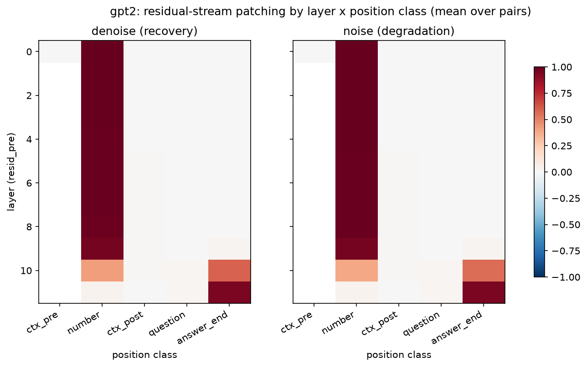

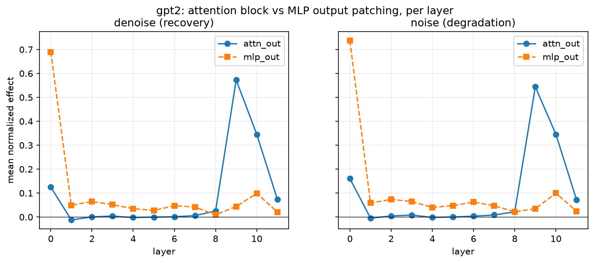

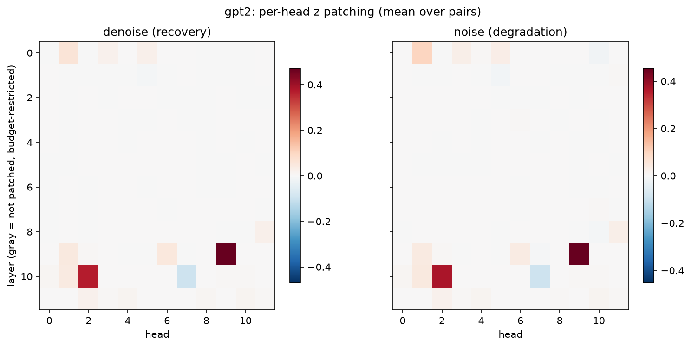

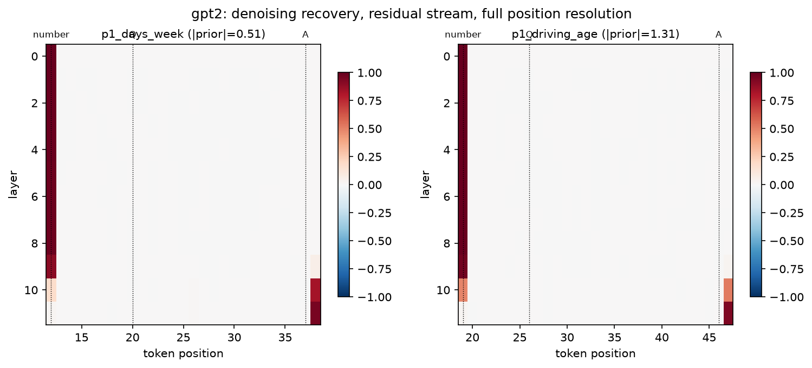

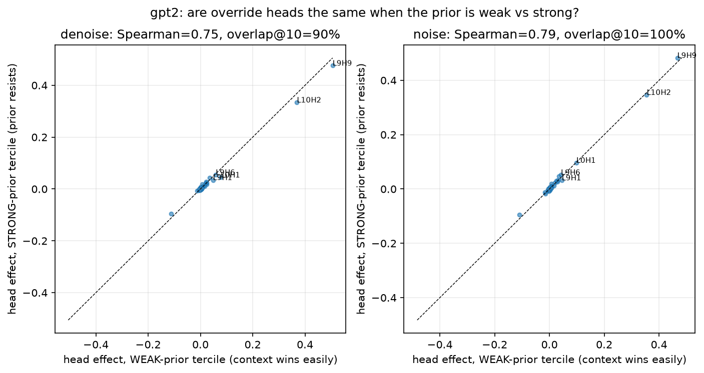

### Top-10 heads by mean effect (bootstrap 95% CI over pairs, 2000 resamples)

| direction | unit | mean | median | ci_lo | ci_hi |
| --- | --- | --- | --- | --- | --- |
| denoise | L9H9 | 0.471 | 0.461 | 0.441 | 0.505 |
| denoise | L10H2 | 0.369 | 0.386 | 0.334 | 0.404 |
| denoise | L0H1 | 0.062 | 0.067 | 0.052 | 0.072 |
| denoise | L9H6 | 0.048 | 0.032 | 0.031 | 0.065 |
| denoise | L9H1 | 0.048 | 0.045 | 0.036 | 0.060 |
| denoise | L10H1 | 0.042 | 0.046 | 0.032 | 0.050 |
| denoise | L8H11 | 0.025 | 0.024 | 0.020 | 0.031 |
| denoise | L0H5 | 0.024 | 0.021 | 0.020 | 0.029 |
| denoise | L0H3 | 0.021 | 0.020 | 0.018 | 0.025 |
| denoise | L11H2 | 0.021 | 0.019 | 0.016 | 0.026 |
| noise | L9H9 | 0.454 | 0.435 | 0.423 | 0.487 |
| noise | L10H2 | 0.369 | 0.372 | 0.334 | 0.402 |
| noise | L0H1 | 0.096 | 0.094 | 0.084 | 0.108 |
| noise | L10H1 | 0.043 | 0.046 | 0.034 | 0.052 |
| noise | L9H1 | 0.042 | 0.039 | 0.033 | 0.053 |
| noise | L9H6 | 0.038 | 0.020 | 0.022 | 0.056 |
| noise | L0H5 | 0.030 | 0.029 | 0.025 | 0.034 |
| noise | L8H11 | 0.026 | 0.022 | 0.021 | 0.033 |
| noise | L0H3 | 0.026 | 0.024 | 0.022 | 0.031 |
| noise | L11H2 | 0.021 | 0.018 | 0.016 | 0.026 |

### Central question (2d): weak-prior vs strong-prior head rankings

- **denoise**: Spearman rank correlation = 0.752 (n_weak=10, n_strong=10); overlap@5=80%, overlap@10=90%, overlap@20=90%.
- **noise**: Spearman rank correlation = 0.787 (n_weak=10, n_strong=10); overlap@5=80%, overlap@10=100%, overlap@20=85%.

### Sanity / robustness

- Negative check: 20 heads sampled from the bottom half by |effect| -> mean 0.0002 (sd 0.0003, max |effect| 0.0006).
- Control `p1_ctrl_indemnification_section`: LD_clean=1.711, LD_corr=0.243, denominator=1.467.
- Control `p1_ctrl_governing_law_section`: LD_clean=2.031, LD_corr=-0.611, denominator=2.642.
- Controls' number-position residual patching: max-over-layers recovery 1.010 (clean pairs: 1.000).

## Results: pythia-160m

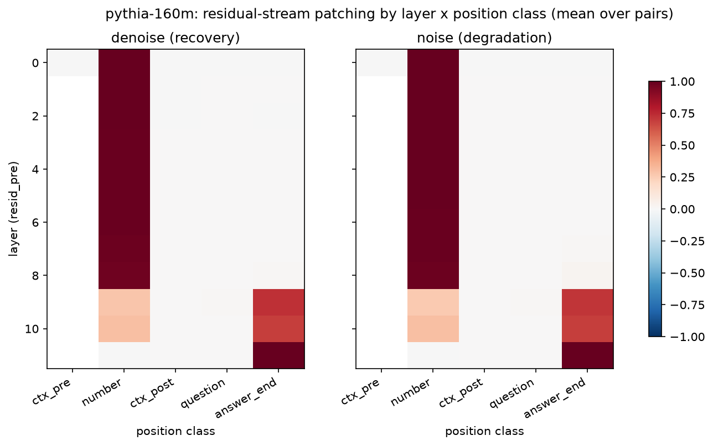

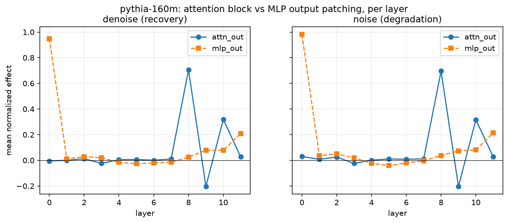

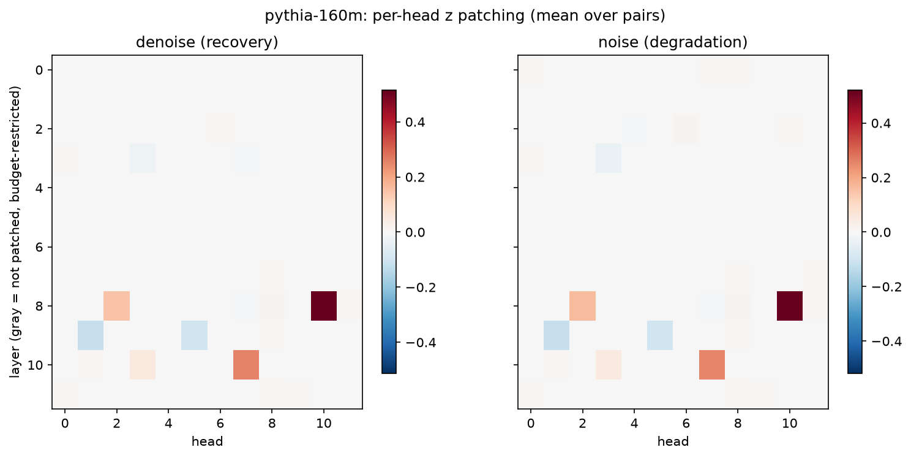

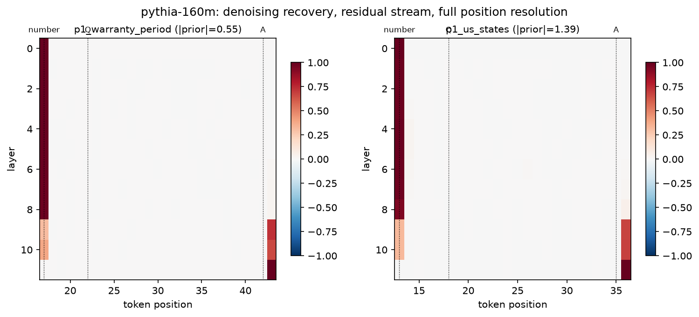

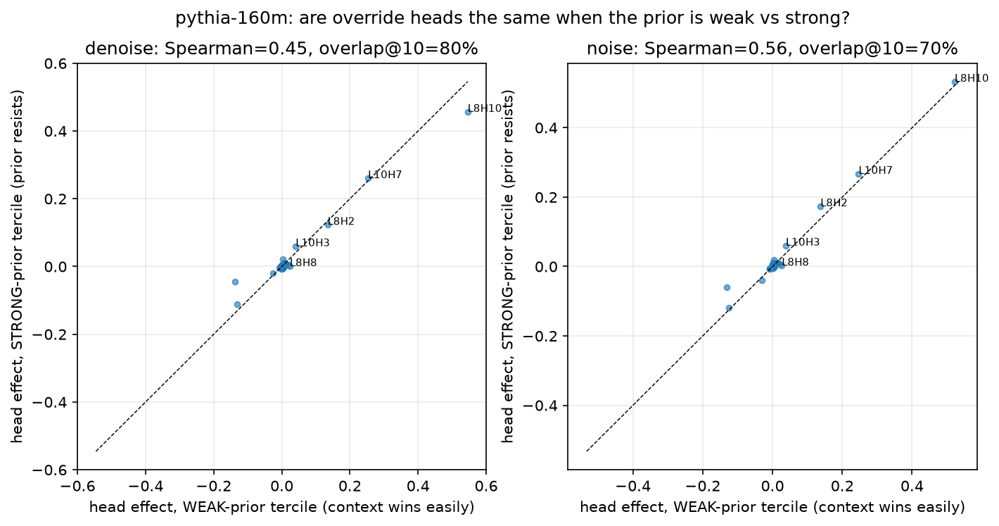

### Top-10 heads by mean effect (bootstrap 95% CI over pairs, 2000 resamples)

| direction | unit | mean | median | ci_lo | ci_hi |
| --- | --- | --- | --- | --- | --- |
| denoise | L8H10 | 0.514 | 0.522 | 0.459 | 0.569 |
| denoise | L10H7 | 0.254 | 0.232 | 0.211 | 0.303 |
| denoise | L8H2 | 0.148 | 0.160 | 0.117 | 0.177 |
| denoise | L10H3 | 0.049 | 0.036 | 0.034 | 0.066 |
| denoise | L8H8 | 0.015 | 0.000 | 0.006 | 0.023 |
| denoise | L2H6 | 0.012 | 0.010 | 0.009 | 0.015 |
| denoise | L10H1 | 0.012 | 0.002 | 0.003 | 0.022 |
| denoise | L11H8 | 0.009 | 0.010 | 0.006 | 0.012 |
| denoise | L7H8 | 0.009 | 0.005 | 0.005 | 0.013 |
| denoise | L8H11 | 0.008 | 0.001 | 0.002 | 0.016 |
| noise | L8H10 | 0.520 | 0.542 | 0.468 | 0.570 |
| noise | L10H7 | 0.252 | 0.237 | 0.208 | 0.301 |
| noise | L8H2 | 0.164 | 0.175 | 0.132 | 0.195 |
| noise | L10H3 | 0.047 | 0.035 | 0.034 | 0.064 |
| noise | L8H8 | 0.016 | 0.001 | 0.007 | 0.025 |
| noise | L2H6 | 0.015 | 0.013 | 0.011 | 0.019 |
| noise | L7H11 | 0.011 | 0.008 | 0.007 | 0.015 |
| noise | L10H1 | 0.011 | 0.002 | 0.003 | 0.020 |
| noise | L8H11 | 0.010 | 0.001 | 0.003 | 0.018 |
| noise | L11H8 | 0.009 | 0.010 | 0.006 | 0.012 |

### Central question (2d): weak-prior vs strong-prior head rankings

- **denoise**: Spearman rank correlation = 0.448 (n_weak=10, n_strong=10); overlap@5=80%, overlap@10=80%, overlap@20=65%.
- **noise**: Spearman rank correlation = 0.565 (n_weak=10, n_strong=10); overlap@5=80%, overlap@10=70%, overlap@20=65%.

### Sanity / robustness

- Negative check: 20 heads sampled from the bottom half by |effect| -> mean 0.0001 (sd 0.0002, max |effect| 0.0005).
- Control `p1_ctrl_indemnification_section`: LD_clean=1.093, LD_corr=0.907, denominator=0.186.
- Control `p1_ctrl_governing_law_section`: LD_clean=0.366, LD_corr=0.150, denominator=0.216.
- No control survived the denominator filter for patching (see exclusions above); behavioral baselines reported instead.

## Cross-model comparison

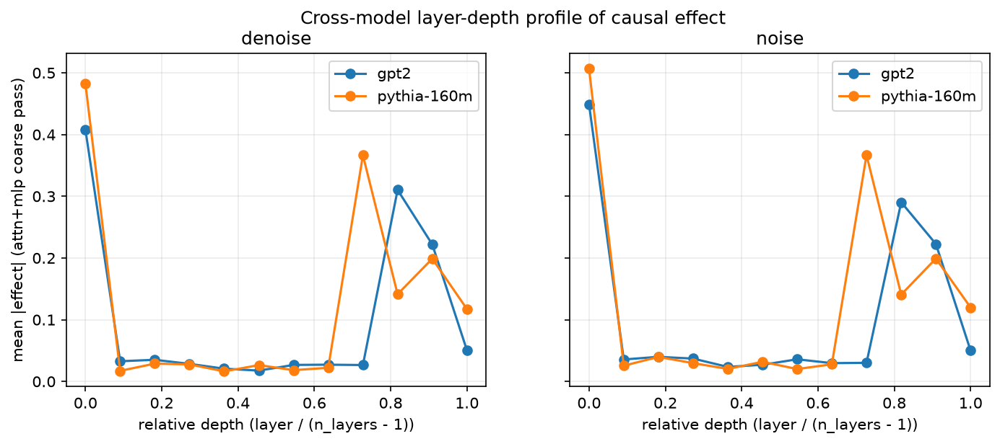

- denoise: Spearman of per-layer |effect| profiles (relative depth) = 0.601. Head indices do not correspond across architectures, so comparison is by functional depth, not head identity.
- noise: Spearman of per-layer |effect| profiles (relative depth) = 0.629. Head indices do not correspond across architectures, so comparison is by functional depth, not head identity.

## Limitations

- Patched activations are off-manifold inputs to downstream components; single-token, single-position prompt differences keep the intervention as close to on-distribution as this method allows, but z-patches in particular can have OOD effects (Heimersheim & Nanda 2024, sec. on interpretation pitfalls).
- ~30 pairs/model, single prompt template, single-token answers only: findings are about THIS task format at THIS scale.
- Head-level pass may be budget-restricted to coarse-flagged layers (stated per model above); unflagged layers have no head-level estimates (gray in heatmaps), not zero estimates.
- Pythia-160M uses parallel attention/MLP blocks: attn_out and mlp_out read the SAME resid_pre, so the attn-vs-MLP decomposition is not architecturally identical to GPT-2's sequential blocks.
- Only 2 copy-fidelity controls; their evidence is anecdotal.
- The world_numeric domain is not legal text; it is flagged in the data and results can be recomputed excluding it.

## Critical assessment

### Verdict: context-override is sharply localized — 2–3 late attention heads per model carry most of the causal effect — and the circuit is SHARED between "context wins easily" and "prior resists" pairs. The central question has a clear answer at this granularity: no dissociable resistance circuit.

Written by hand after inspecting the cached numbers and figures; not generated
by the analysis script. Phase 2 (ablation validation + attribution) has NOT
been run — everything below is patching evidence only, and the head
interpretations are hypotheses until Phase 2 tests them.

#### The mechanism the data shows

1. **The context number stays put, then hops.** Full-position residual
   patching shows the critical number's information sitting at its own
   context position from L0 through ~L9 (recovery 0.96–1.00), then appearing
   at the final answer position in the last layers (GPT-2: answer_end 0.59 at
   L10 → 0.94 at L11; Pythia: 0.73 at L9 → 1.00 at L11). No intermediate
   positions are ever implicated — a direct attention hop, not a relay chain.

2. **The hop is attention, and it is 2–3 heads.** Coarse patching puts the
   movement in attn_out (GPT-2: L9 = 0.57, L10 = 0.35 vs MLP ≤ 0.10 past L0;
   Pythia: L8 = 0.70, L10 = 0.32). Head-level patching resolves it further:
   - **GPT-2: L9H9 = 0.47 [0.44, 0.51] and L10H2 = 0.37 [0.33, 0.40]** —
     together ~0.84 of the full effect; the 3rd-ranked head is 7× smaller.
   - **Pythia: L8H10 = 0.51 [0.46, 0.57], L10H7 = 0.25, L8H2 = 0.15** —
     top-3 ≈ 0.92 of the effect.
   The L0-MLP effect (0.69 / 0.95) is token-identity encoding at the number
   position, expected and not circuit-specific.

3. **Denoising ≈ noising for the top heads** (e.g. L9H9: 0.47 vs 0.45).
   Each top head is individually both ~sufficient and ~necessary for its
   share of the effect; single-head patching shows no backup-head
   compensation of the kind IOI found for name movers — though patching one
   head at a time cannot rule out joint redundancy among untested subsets.

4. **Central question (2d): SHARED.** Splitting pairs by measured prior
   strength (bottom vs top tercile): the same heads top both rankings in both
   models — GPT-2 Spearman 0.75/0.79 (denoise/noise), overlap@10 = 90%/100%;
   Pythia 0.45/0.56 with overlap@5 = 80%. Pythia's lower full-rank Spearman
   is a floor artifact: most of its 144 heads have ~0 effect, and ranks
   within that cloud are noise; the scatter shows the meaningful heads on the
   diagonal. **We found no head that matters for override when the prior is
   weak but not when it is strong, or vice versa.** The prior's resistance
   shows up in the *baselines* (how far LD_clean sits from the context
   answer), not in *which components* carry the context signal. "Defer to
   evidence" and "resist corrupted evidence" — operationalized this way —
   are one circuit with a shifting balance, not two circuits.

5. **Cross-model convergence by functional depth.** Both models place their
   mover heads at relative depth 0.67–0.83 (L9–10 of 12; L8/L10 of 12), with
   near-identical depth profiles (L0 encoding spike, flat middle, late bump;
   profile Spearman 0.60/0.63 — moderate because the flat middle contributes
   rank noise). Head *identities* cannot correspond across architectures;
   the functional motif does.

#### Sanity checks

- Negative floor: 20 bottom-half heads → mean effect 0.0002 (max 0.0006). Clean.
- GPT-2 copy controls: number-position recovery ≈ 1.01 vs 1.00 for clean
  pairs — section-number copying behaves like the numeric task, as expected.
- **Pythia's controls could not be patched**: their behavioral effect is
  near-absent (denominators 0.19/0.216 < 1.0 gate), replicating the pilot's
  finding that Pythia barely copies section numbers. The copy-control check
  is therefore *unavailable* for Pythia, not passed.

#### Honest problems and surprises

- **The denominator gate creates a selection effect on the central
  question.** Pythia's two excluded non-control pairs (triangle_sides,
  earth_moons) are precisely ultra-entrenched priors where context barely
  moves the model. The "shared circuit" claim is established on pairs where
  the context edit produces ≥1 logit of behavioral movement; it may not
  extend to the extreme-resistance regime we excluded. GPT-2 had no
  exclusions, which limits (but does not eliminate) the concern.
- **Negative heads exist and are uncharacterized.** Pythia L9 attn_out has a
  consistent negative effect (−0.20); GPT-2 L10H7 ≈ −0.1. Patching *clean*
  activations into these components *hurts* override recovery —
  suppression-like dynamics we have not explained. Phase 2 material.
- **The compute-budget reduction was a no-op due to a scoring bug** (noising
  rows entered the layer-flag score as raw recovery ≈ 1). Consequence: full
  coverage, nothing subsampled, wall-clock 206 min vs the ~2h budget. Fixed
  in code post-run; disclosed in the report.
- Top-head effects are slightly smaller in the strong-prior tercile (e.g.
  L8H10: 0.55 weak vs 0.46 strong) — same components, marginally smaller
  normalized share when the prior fights back. CIs overlap; do not over-read.

#### Standing limitations

Head z-patches applied at all positions (not position-restricted); one prompt
template; single-token answers; ~30 pairs/model; 2 controls; normalized
metric hides absolute logit scales; Pythia's parallel attn/MLP blocks make
the attn-vs-MLP split architecturally non-identical to GPT-2's.

#### What Phase 2 should test (pending sign-off — nothing built)

1. **Ablation validation** (ablate.py): knock out L9H9/L10H2 (GPT-2) and
   L8H10/L10H7/L8H2 (Pythia) on fresh prompts; the localization claim
   predicts a large, specific drop in context-following.
2. **Attribution** (attribution.py): attention patterns (do these heads
   attend final→number?) and direct logit attribution (do their OV outputs
   write the context-answer direction?) to test the "mover head" reading.
3. Characterize the negative/suppression heads.
4. If budget allows: path patching L9H9→L10H2 composition (GPT-2).
