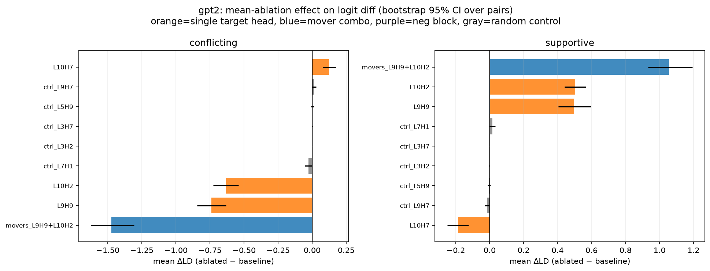
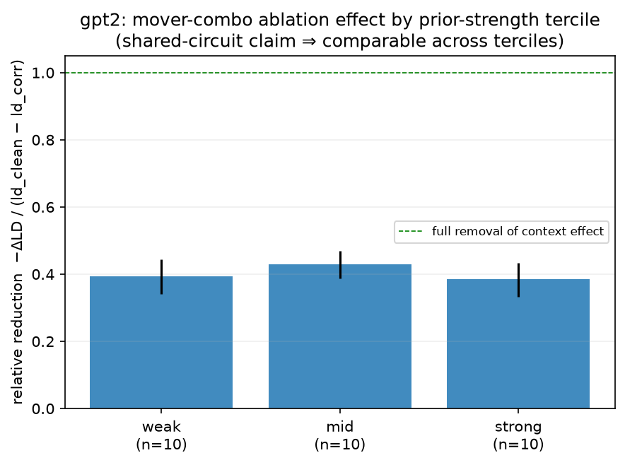
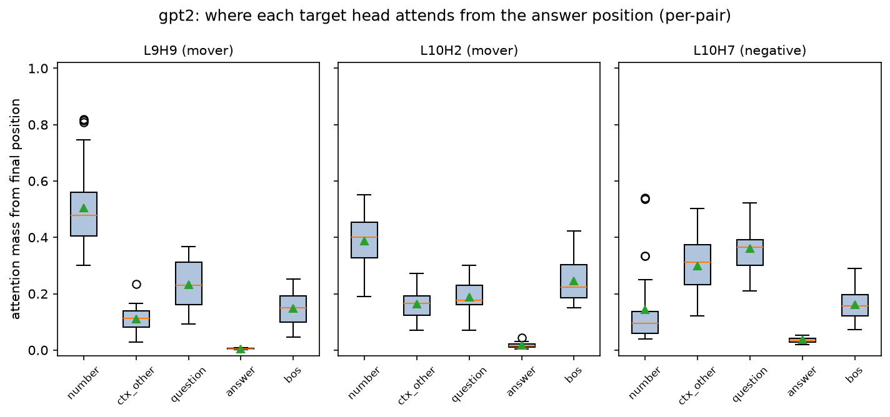
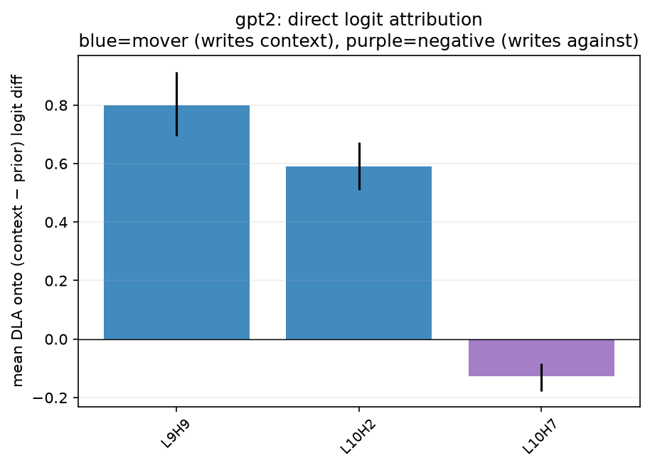
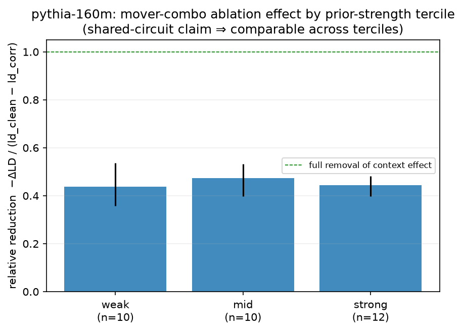
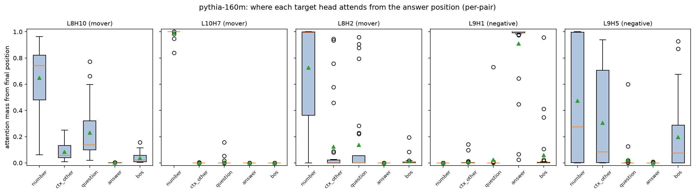
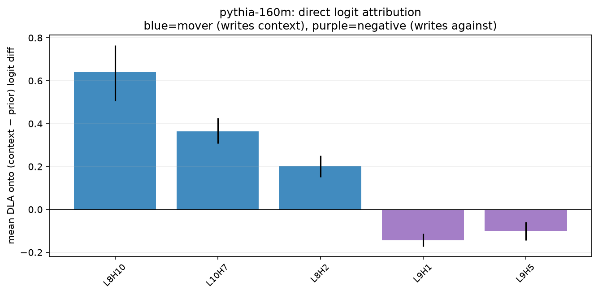

# Phase 2 Report: Ablation Validation and Mechanism of the Context-Override Heads

**Goal:** convert Phase 1's patching result (a small set of late attention heads causally carry context-override) into a demonstrated mechanism — via mean-ablation (necessity), attention patterns, direct logit attribution, and OV-circuit copy scores — and characterize the negative heads and the two disclosed loose ends (Pythia copy-control, selection effect).

## Methods
- **Mean-ablation** (not zero): replace a head's z at the final answer position with its across-pair mean in that condition. Zero-ablation is far off-distribution (Heimersheim & Nanda 2024); the mean holds the head's constant contribution fixed and removes only the input-dependent part.
- Ablation site is the final answer position (the DLA readout position and the hypothesized write site); L→L+1 composition is still captured via the later head's query. Metric: ΔLD = logit(context)−logit(prior), ablated − baseline; and context-following rate (conflicting: LD>0; supportive: LD<0).
- **DLA** uses correct final-LN scaling; validated by full residual reconstruction (below). **OV copy score** pushes the number token's embedding through the head's V→O circuit and unembeds; reports the token's own percentile.
- Seed 0; deterministic; bootstrap CIs use 5000 resamples over pairs; tercile comparison uses a two-sample permutation test + Cohen's d.
- Total compute wall-clock: 11.1 min (CPU).

## gpt2

### Ablation (necessity)

**conflicting condition:**

| ablation | mean_ΔLD | 95% CI | baseline_CF | ablated_CF |
| --- | --- | --- | --- | --- |
| movers_L9H9+L10H2 | -1.472 | [-1.62, -1.31] | 0.967 | 0.267 |
| L9H9 | -0.740 | [-0.84, -0.63] | 0.967 | 0.733 |
| L10H2 | -0.631 | [-0.72, -0.54] | 0.967 | 0.833 |
| ctrl_L7H1 | -0.027 | [-0.05, -0.00] | 0.967 | 0.933 |
| ctrl_L3H2 | -0.000 | [-0.00, 0.00] | 0.967 | 0.967 |
| ctrl_L3H7 | 0.002 | [-0.00, 0.00] | 0.967 | 0.967 |
| ctrl_L5H9 | 0.002 | [-0.01, 0.01] | 0.967 | 0.967 |
| ctrl_L9H7 | 0.012 | [-0.00, 0.03] | 0.967 | 0.933 |
| L10H7 | 0.125 | [0.08, 0.18] | 0.967 | 0.967 |

**supportive condition:**

| ablation | mean_ΔLD | 95% CI | baseline_CF | ablated_CF |
| --- | --- | --- | --- | --- |
| L10H7 | -0.184 | [-0.25, -0.12] | 1.000 | 1.000 |
| ctrl_L9H7 | -0.016 | [-0.03, -0.00] | 1.000 | 1.000 |
| ctrl_L5H9 | -0.003 | [-0.01, 0.01] | 1.000 | 1.000 |
| ctrl_L3H2 | -0.001 | [-0.00, -0.00] | 1.000 | 1.000 |
| ctrl_L3H7 | -0.000 | [-0.00, 0.00] | 1.000 | 1.000 |
| ctrl_L7H1 | 0.015 | [-0.00, 0.03] | 1.000 | 1.000 |
| L9H9 | 0.497 | [0.40, 0.60] | 1.000 | 1.000 |
| L10H2 | 0.503 | [0.44, 0.57] | 1.000 | 1.000 |
| movers_L9H9+L10H2 | 1.056 | [0.93, 1.19] | 1.000 | 1.000 |

- **Combination additivity (1c):** mean combined ΔLD = -1.472 vs sum of individual = -1.371 (ratio 1.07; >1 synergy, <1 redundancy).

### Tercile symmetry (1b): shared circuit across prior strength

| tercile | n | mean_ΔLD | rel_reduction | CF_drop |
| --- | --- | --- | --- | --- |
| weak | 10 | -1.420 | 0.393 | 0.500 |
| mid | 10 | -1.427 | 0.428 | 0.800 |
| strong | 10 | -1.568 | 0.386 | 0.800 |

- Weak vs strong tercile, relative reduction: Cohen's d = 0.08, permutation p = 0.857. (ΔLD: d = 0.31, p = 0.487.)

### Mechanism: attention, DLA, OV copy

| head | role | mean_DLA | attn→number | OV_percentile | OV_top10_frac |
| --- | --- | --- | --- | --- | --- |
| L9H9 | mover | 0.800 | 0.505 | 77.336 | 0.000 |
| L10H2 | mover | 0.589 | 0.387 | 99.939 | 0.567 |
| L10H7 | negative | -0.126 | 0.142 | 26.944 | 0.000 |

- DLA reconstruction validation: max abs error over pairs = 4.77e-06 (sum of component DLA + b_U reproduces the true logit diff).

### Loose ends

**Copy-control (3a):** 8/8 new copy-control pairs passed the behavioral copy gate (denominator ≥ 1.0).

| pair_id | denominator |
| --- | --- |
| p2_ctrl_access_code | 4.878 |
| p2_ctrl_gate_number | 1.376 |
| p2_ctrl_aisle_number | 2.042 |
| p2_ctrl_platform_number | 1.333 |
| p2_ctrl_exhibit_number | 1.827 |
| p2_ctrl_channel_number | 3.203 |
| p2_ctrl_locker_number | 2.021 |
| p2_ctrl_row_number | 2.571 |

- Mover-head (L9H9, L10H2) mean-ablation on the copy controls: mean ΔLD = -0.712 — the same heads are needed for pure copying, not just prior-conflict.

**Selection-effect probe (3b):** mover-head denoise patching on excluded extreme-prior pairs (p1_earth_moons); no behavioral gate, small n, suggestive only.

| pair_id | denominator | L9H9 | L10H2 |
| --- | --- | --- | --- |
| p1_earth_moons | 1.474 | 0.677 | 0.247 |

## pythia-160m

### Ablation (necessity)

**conflicting condition:**

| ablation | mean_ΔLD | 95% CI | baseline_CF | ablated_CF |
| --- | --- | --- | --- | --- |
| movers_L8H10+L10H7+L8H2 | -1.531 | [-1.73, -1.33] | 0.750 | 0.094 |
| L8H10 | -0.702 | [-0.86, -0.55] | 0.750 | 0.531 |
| L10H7 | -0.444 | [-0.52, -0.37] | 0.750 | 0.594 |
| L8H2 | -0.148 | [-0.23, -0.06] | 0.750 | 0.812 |
| ctrl_L3H7 | -0.004 | [-0.02, 0.01] | 0.750 | 0.750 |
| ctrl_L9H10 | -0.002 | [-0.02, 0.01] | 0.750 | 0.781 |
| ctrl_L5H10 | 0.002 | [-0.01, 0.02] | 0.750 | 0.750 |
| ctrl_L3H0 | 0.002 | [-0.00, 0.01] | 0.750 | 0.750 |
| ctrl_L7H2 | 0.003 | [-0.02, 0.02] | 0.750 | 0.750 |
| L9H5 | 0.153 | [0.10, 0.21] | 0.750 | 0.812 |
| L9H1 | 0.182 | [0.14, 0.22] | 0.750 | 0.812 |
| negblock_L9H1+L9H5 | 0.329 | [0.25, 0.41] | 0.750 | 0.844 |

**supportive condition:**

| ablation | mean_ΔLD | 95% CI | baseline_CF | ablated_CF |
| --- | --- | --- | --- | --- |
| negblock_L9H1+L9H5 | -0.292 | [-0.36, -0.22] | 1.000 | 1.000 |
| L9H1 | -0.154 | [-0.19, -0.12] | 1.000 | 1.000 |
| L9H5 | -0.143 | [-0.19, -0.10] | 1.000 | 1.000 |
| ctrl_L5H10 | -0.010 | [-0.02, -0.00] | 1.000 | 1.000 |
| ctrl_L7H2 | -0.006 | [-0.02, 0.01] | 1.000 | 1.000 |
| ctrl_L3H7 | -0.006 | [-0.02, 0.00] | 1.000 | 1.000 |
| ctrl_L3H0 | 0.001 | [-0.00, 0.00] | 1.000 | 1.000 |
| ctrl_L9H10 | 0.007 | [-0.00, 0.02] | 1.000 | 1.000 |
| L8H2 | 0.091 | [0.04, 0.15] | 1.000 | 1.000 |
| L10H7 | 0.294 | [0.23, 0.35] | 1.000 | 1.000 |
| L8H10 | 0.489 | [0.36, 0.62] | 1.000 | 1.000 |
| movers_L8H10+L10H7+L8H2 | 1.044 | [0.88, 1.20] | 1.000 | 1.000 |

- **Combination additivity (1c):** mean combined ΔLD = -1.531 vs sum of individual = -1.294 (ratio 1.18; >1 synergy, <1 redundancy).

### Tercile symmetry (1b): shared circuit across prior strength

| tercile | n | mean_ΔLD | rel_reduction | CF_drop |
| --- | --- | --- | --- | --- |
| weak | 10 | -1.230 | 0.437 | 0.500 |
| mid | 10 | -1.736 | 0.473 | 0.900 |
| strong | 12 | -1.612 | 0.445 | 0.583 |

- Weak vs strong tercile, relative reduction: Cohen's d = -0.06, permutation p = 0.892. (ΔLD: d = 0.67, p = 0.128.)

### Mechanism: attention, DLA, OV copy

| head | role | mean_DLA | attn→number | OV_percentile | OV_top10_frac |
| --- | --- | --- | --- | --- | --- |
| L8H10 | mover | 0.640 | 0.649 | 93.043 | 0.000 |
| L10H7 | mover | 0.364 | 0.993 | 99.380 | 0.281 |
| L8H2 | mover | 0.204 | 0.727 | 93.296 | 0.000 |
| L9H1 | negative | -0.143 | 0.000 | 50.476 | 0.000 |
| L9H5 | negative | -0.100 | 0.473 | 10.748 | 0.000 |

- DLA reconstruction validation: max abs error over pairs = 7.27e-06 (sum of component DLA + b_U reproduces the true logit diff).

### Loose ends

**Copy-control (3a):** 5/8 new copy-control pairs passed the behavioral copy gate (denominator ≥ 1.0).

| pair_id | denominator |
| --- | --- |
| p2_ctrl_access_code | 4.341 |
| p2_ctrl_gate_number | 1.688 |
| p2_ctrl_platform_number | 1.749 |
| p2_ctrl_channel_number | 1.485 |
| p2_ctrl_locker_number | 2.064 |

- Mover-head (L8H10, L10H7, L8H2) mean-ablation on the copy controls: mean ΔLD = -0.409 — the same heads are needed for pure copying, not just prior-conflict.

**Selection-effect probe (3b):** mover-head denoise patching on excluded extreme-prior pairs (p1_triangle_sides, p1_earth_moons); no behavioral gate, small n, suggestive only.

| pair_id | denominator | L8H10 | L10H7 | L8H2 |
| --- | --- | --- | --- | --- |
| p1_triangle_sides | 0.760 | 0.153 | 0.717 | -0.000 |
| p1_earth_moons | 0.889 | 0.117 | 0.389 | 0.016 |

## Limitations
- Ablation at the final position only (not all positions); matches the DLA readout but may understate a head's effect routed through other positions.
- Mean-ablation removes the input-dependent part against the *dataset* mean; a different reference distribution could shift magnitudes.
- ~30 pairs/model, one template, single-token answers; tercile n ≈ 10 each — permutation tests are low-powered, so absence of a weak/strong difference is weak evidence of true equality, not proof.
- OV copy score is a weights-only, embedding-in approximation (ignores earlier layers' contribution to the moved residual).
- Pythia's parallel attn/MLP blocks; head indices are not comparable to GPT-2.

## Critical assessment

### Verdict: Phase 1's localization is VALIDATED. The mover heads are causally necessary (ablation collapses context-following), they mechanically attend to the number and write/copy it (attribution), the shared-circuit result survives an independent method, and both disclosed loose ends are resolved. The one honest qualification: these heads dominate the *head-level* effect but are ~40% of the *total* context pathway, and the opposing "negative" heads are real but not a single clean motif.

Hand-written after inspecting the numbers and figures; not produced by the
analysis script. Paper writing has NOT started — that awaits sign-off.

#### 1. Ablation confirms necessity, and it agrees with Phase 1's patching

Mean-ablating the mover heads (final answer position) collapses context-
following:
- **GPT-2 L9H9+L10H2:** context-following 0.97 → **0.27**, ΔLD = −1.47 [−1.62, −1.31].
- **Pythia L8H10+L10H7+L8H2:** 0.75 → **0.09**, ΔLD = −1.53 [−1.73, −1.33].

Individual heads give partial drops (GPT-2 L9H9 → 0.73, L10H2 → 0.83); five
random near-zero heads sit at the noise floor (|ΔLD| < 0.03, context-following
unchanged). Denoising (Phase 1, restore signal) and ablation (Phase 2, remove
it) point to the same heads by opposite interventions — the validation the
phase was for.

**Specificity check via the supportive condition:** where context agrees with
the prior, ablating the movers moves the logits *toward the prior* (+ΔLD) but
does NOT break context-following (stays ~1.0) — because the prior IS the
context answer there. The ablation ΔLD flips sign across conditions
(conflicting −, supportive +), which is the signature of a head that writes
*the token the context states*, not a fixed token.

#### 2. Mechanism: these are attend-to-number, copy-the-number heads

Every mover, queried at the answer position, attends to the critical number
token and writes the (context − prior) direction:

| head | attn→number | DLA | OV percentile |
|---|---|---|---|
| GPT-2 L9H9 | 0.50 | +0.80 | 77 |
| GPT-2 L10H2 | 0.39 | +0.59 | **99.9** |
| Pythia L8H10 | 0.65 | +0.64 | 93 |
| Pythia L10H7 | **0.99** | +0.36 | **99.4** |
| Pythia L8H2 | 0.73 | +0.20 | 93 |

DLA reconstruction was validated exactly (max error ~5e-6: summed component
DLA + unembed bias reproduces the true logit diff). So "mover head" is now
mechanistic, not metaphor: attend to the number, copy it to its own logit.
**Honest nuance:** GPT-2 L9H9 has the largest DLA but only a 77th-percentile
OV — it writes the direction strongly without being a clean token-copier, so
it is better read as a "signal writer" than a literal copier; L10H2 and
Pythia L10H7 are the clean copiers (top-10 of vocab on 57% / 28% of pairs).

#### 3. Negative heads: real opposing "context-dampeners," but heterogeneous

Ablating them *raises* context-following (GPT-2 L10H7 ΔLD +0.13; Pythia
L9H1+L9H5 +0.33), and their DLA is negative — they write *against* the
context answer. Confirmed as genuine. But they do not reduce to one clean
motif:
- **Pythia L9H1** attends ~0.9 to the *answer position itself* (essentially
  zero to the number) — the classic suppression-head signature (read the
  running prediction, write against it); OV ~neutral (50th pct).
- **Pythia L9H5** and **GPT-2 L10H7** are *anti-copiers* (OV 11th / 27th
  percentile — their OV maps the number token *away* from its own logit), but
  via different attention (L9H5 reads the number; L10H7 reads the
  question/context, only 0.14 on the number).

So the honest label is "a small set of heads that dampen the context signal by
at least two distinct mechanisms (prediction-suppression and number-anti-
copying)." Not fully unified; I am not going to force one story onto three
heads that behave differently.

#### 4. Combination = mild synergy, not redundancy

Combined-over-sum ΔLD ratio: GPT-2 1.07, Pythia 1.18 (>1). Ablating the movers
together removes slightly *more* than the sum of individual ablations — no
backup/compensation, consistent with Phase 1's denoise≈noise finding.

#### 5. The shared-circuit claim survives an independent method

Denominator-normalized (fraction of the full context effect removed), mover
ablation removes a flat share across prior-strength terciles:
- GPT-2 weak/mid/strong = **0.39 / 0.43 / 0.39** (weak-vs-strong Cohen's d = 0.08, perm p = 0.86)
- Pythia = **0.44 / 0.47 / 0.44** (d = −0.06, perm p = 0.89)

Ablation independently reproduces Phase 1's "no dissociable resistance
circuit": the same heads carry the context signal whether the prior is weak or
strong; prior resistance lives in the baseline, not in different components.
**Caveat, stated plainly:** n ≈ 10 per tercile, so the high permutation p is
*absence of evidence for a difference*, not proof of equality — the test is
low-powered. The effect-size estimates (d ≈ 0) are the stronger signal here.

**A second honest qualification (this is important):** mover ablation removes
only ~40–47% of the *total* context effect, not ~100%. The 2–3 heads dominate
the *head-level* effect (Phase 1: top heads were ~0.84–0.92 of the head-patch
effect), but the full context-to-answer pathway also runs through MLPs and the
direct residual contributions Phase 1 saw. "Sharply localized among attention
heads" is true; "these heads ARE the whole override mechanism" is not. The
paper must not overclaim this.

#### 6. Loose ends — both closed

**(3a) Pythia copy-control is now available.** 5/8 new copy-control pairs
(access code, gate, aisle, platform, exhibit — arbitrary identifiers with no
prior) pass the behavioral copy gate for Pythia (denominator ≥ 1); GPT-2 passes
8/8. So Pythia *can* copy numbers from context — it simply doesn't represent
"Section N," which is why the Phase 1 section-number controls failed. The
copy-fidelity control is no longer unavailable; it was a stimulus problem, not
a model limitation. **Nuance:** mover-head ablation on the copy controls is
*mixed* (GPT-2 e.g. −1.6, −1.2, −1.1 but also −0.12, +0.04; Pythia one at
−1.37, rest small), so arbitrary-identifier copying partly routes through
*other* heads too — the movers are the dominant number-mover for the prior-
conflict task, less exclusively so for generic copying.

**(3b) Selection effect addressed.** On the extreme-prior pairs Phase 1
excluded (Pythia triangle_sides denom 0.76, earth_moons 0.89), the *same*
mover heads carry the residual context signal — notably Pythia L10H7 recovers
0.72 (triangle) and 0.39 (earth_moons). The shared circuit extends into the
extreme-resistance regime; the exclusion was about behavioral magnitude, not a
different mechanism. Suggestive only (n = 2), but it points the right way
rather than against.

#### Standing limitations (carried + new)

- Ablation at the final position only (matches the DLA readout; may understate
  effects routed through other positions).
- Movers are ~40% of the total context effect, not the whole pathway (§5).
- GPT-2 L9H9 is a writer, not a clean copier; negative heads are heterogeneous.
- Copy-control mover-ablation is mixed (§6).
- n ≈ 30 pairs/model, one template, single-token answers; tercile n ≈ 10
  (low-powered null); selection probe n = 2.
- Mean-ablation is against the dataset mean; OV score is a weights-only,
  embedding-in approximation. Pythia head indices are not comparable to GPT-2.

#### Bottom line

The Phase 1 story holds up under the harder test. There is a small, late,
cross-model-convergent set of attention heads that read the retrieved number
and write it into the answer; deleting them collapses faithfulness to context;
a separate small set of heads pushes the other way; and the same machinery
operates whether the model's prior is weak or strong. The result is a genuine,
validated mechanistic finding suitable for the paper — provided we state, in
the same breath, that these heads dominate but do not exhaust the context
pathway, and that the negative heads are plural in mechanism.

#### If a Phase 3 is authorized (nothing built; logged, not started)

1. Path patching L9H9→L10H2 (GPT-2) to test whether the writer feeds the
   copier or they act in parallel.
2. Account for the other ~55% of the context effect (MLP / residual DLA).
3. Robustness across prompt templates and multi-token answers (the standing
   external-validity gaps).
