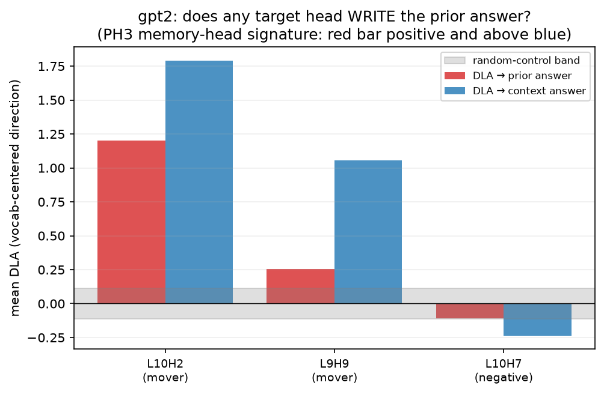
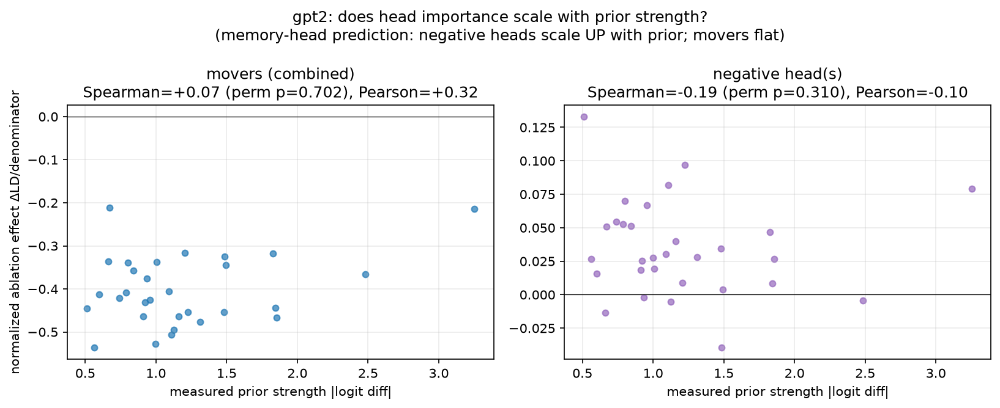
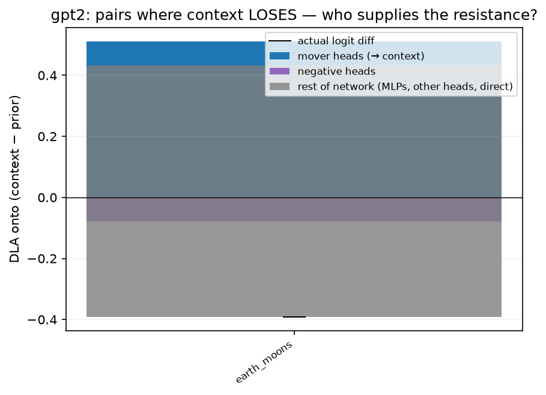
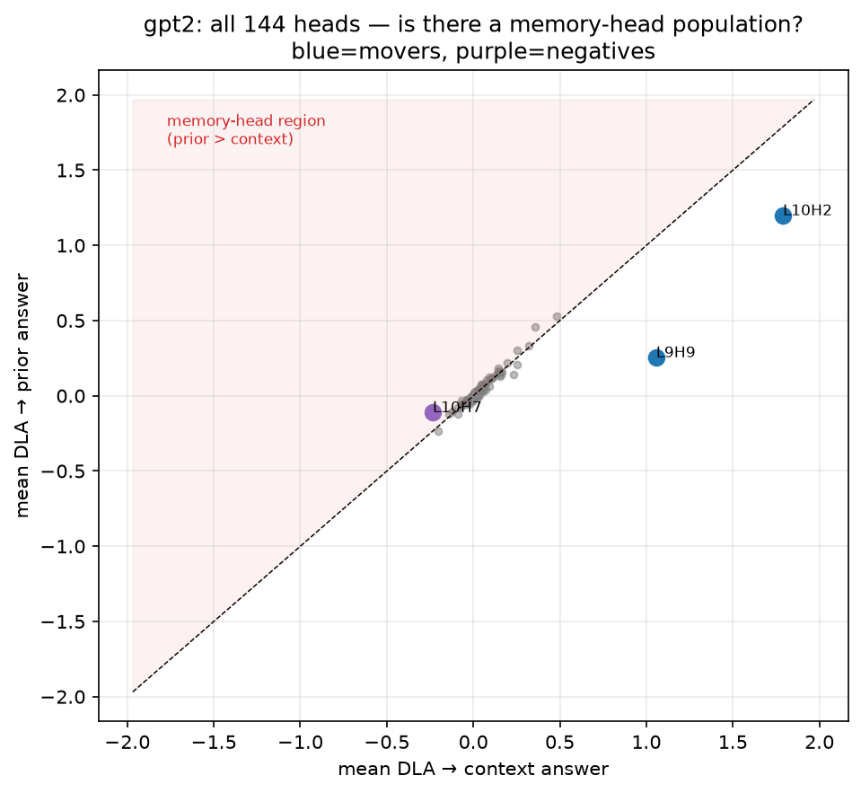
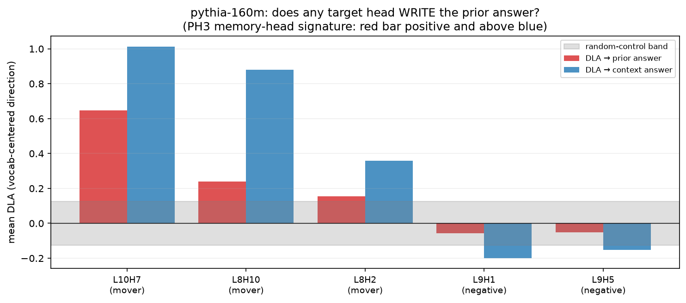
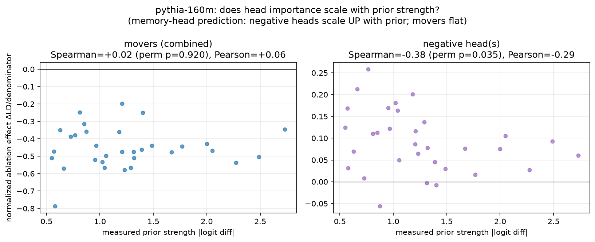
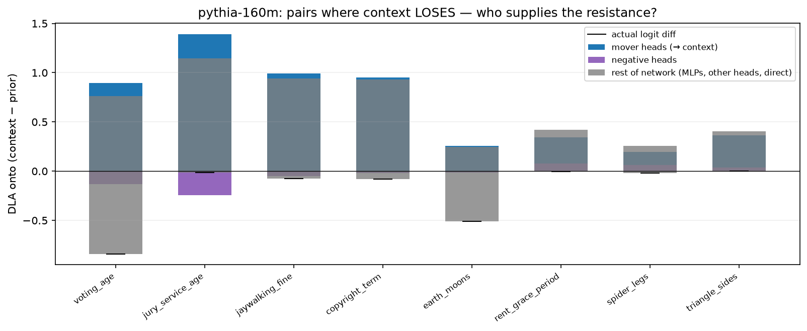

# Phase 3 Report: Memory-Head Reconciliation (vs Jin et al. 2024, PH3)

**Question:** are the negative heads found in Phase 2 the analogue of PH3's memory heads — i.e., is resistance to context a separate, prior-tracking head population rather than a mode of the mover circuit? (arXiv:2402.18154 studies 1.3B–13B models; we test the small-model regime, 124M–160M.)

Seeds: 0 everywhere; bootstrap 5000; permutation 20000. Directional DLA uses vocab-centered unembed directions; the centering-invariant difference reproduces Phase 2's diff-DLA to 2e-07 (internal check). Compute: 8.3 min (CPU).

## gpt2

### 1a. Do the negative heads write the PRIOR answer? (PH3 memory-head signature)

| head | role | dla_prior | prior_CI | dla_context | context_CI | prior_minus_ctx |
| --- | --- | --- | --- | --- | --- | --- |
| L10H2 | mover | 1.200 | [1.07,1.33] | 1.790 | [1.64,1.94] | -0.589 |
| L9H9 | mover | 0.256 | [0.19,0.32] | 1.057 | [0.92,1.22] | -0.800 |
| L10H7 | negative | -0.108 | [-0.15,-0.07] | -0.235 | [-0.32,-0.16] | 0.126 |
| L3H2 | control | 0.036 | [0.03,0.04] | 0.029 | [0.02,0.04] | 0.007 |
| L3H7 | control | -0.042 | [-0.05,-0.03] | -0.030 | [-0.04,-0.02] | -0.011 |
| L5H9 | control | 0.043 | [0.03,0.05] | 0.036 | [0.02,0.05] | 0.007 |
| L7H1 | control | 0.112 | [0.10,0.13] | 0.099 | [0.09,0.11] | 0.013 |
| L9H7 | control | 0.059 | [0.05,0.07] | 0.053 | [0.04,0.07] | 0.006 |

### 1c / 2b. Does head importance scale with prior strength?

- **movers (combined)** (`movers_L9H9+L10H2`, n=30): Spearman = +0.073 (perm p = 0.702), Pearson = +0.316.
- **negative head(s)** (`L10H7`, n=30): Spearman = -0.194 (perm p = 0.310), Pearson = -0.100.
- Negative-head ablation by tercile (normalized): weak = +0.046 [+0.024,+0.070], mid = +0.029 [+0.014,+0.047], strong = +0.028 [+0.006,+0.052]; weak-vs-strong perm p = 0.328.

### 2c. Joint intervention: independent populations or interaction?

- movers only ΔLD = -1.472; negatives only = +0.125; joint = -1.424; additive prediction = -1.347; **interaction = -0.077**.
- interaction = joint − (movers + negatives); ≈0 ⇒ independent populations; >0 (toward context) ⇒ negatives' benefit vanishes without movers (reactive).

### 3a. Tug-of-war on pairs where context loses

| pair_id | prior | mover_DLA | negative_DLA | rest | actual_LD |
| --- | --- | --- | --- | --- | --- |
| p1_earth_moons | 1.226 | 0.511 | -0.079 | -0.824 | -0.391 |

### 3b. Falsification check: do mover heads ever write toward the prior?

- 0/60 (pair × mover-head) DLA values are negative, across 0 pairs (none); most negative = 0.000, mean flip = 0.000.

### Global scan: is there ANY memory-head population we missed?

| head | mean_dla_prior | prior_minus_ctx | spearman_vs_prior | perm_p |
| --- | --- | --- | --- | --- |
| L8H8 | 0.461 | 0.102 | 0.408 | 0.026 |
| L9H2 | 0.300 | 0.049 | 0.062 | 0.744 |
| L11H8 | 0.530 | 0.048 | 0.340 | 0.065 |
| L11H9 | 0.181 | 0.037 | 0.077 | 0.690 |
| L0H6 | 0.125 | 0.034 | 0.219 | 0.245 |

- Heads with prior-lean > 0.1: 2; heads with context-lean < −0.1: 2. Extremes: max prior-lean +0.126 vs max context-lean -0.800.

## pythia-160m

### 1a. Do the negative heads write the PRIOR answer? (PH3 memory-head signature)

| head | role | dla_prior | prior_CI | dla_context | context_CI | prior_minus_ctx |
| --- | --- | --- | --- | --- | --- | --- |
| L10H7 | mover | 0.648 | [0.59,0.71] | 1.012 | [0.94,1.09] | -0.364 |
| L8H10 | mover | 0.239 | [0.17,0.32] | 0.879 | [0.71,1.03] | -0.640 |
| L8H2 | mover | 0.156 | [0.12,0.19] | 0.360 | [0.28,0.43] | -0.204 |
| L9H1 | negative | -0.056 | [-0.08,-0.03] | -0.199 | [-0.24,-0.16] | 0.143 |
| L9H5 | negative | -0.051 | [-0.08,-0.03] | -0.151 | [-0.22,-0.09] | 0.100 |
| L3H0 | control | 0.125 | [0.11,0.14] | 0.111 | [0.09,0.13] | 0.015 |
| L3H7 | control | -0.083 | [-0.10,-0.07] | -0.077 | [-0.09,-0.06] | -0.007 |
| L5H10 | control | 0.002 | [-0.01,0.01] | 0.002 | [-0.00,0.01] | -0.000 |
| L7H2 | control | -0.031 | [-0.04,-0.02] | -0.036 | [-0.05,-0.03] | 0.006 |
| L9H10 | control | -0.010 | [-0.02,0.00] | -0.005 | [-0.02,0.00] | -0.004 |

### 1c / 2b. Does head importance scale with prior strength?

- **movers (combined)** (`movers_L8H10+L10H7+L8H2`, n=32): Spearman = +0.018 (perm p = 0.920), Pearson = +0.057.
- **negative head(s)** (`negblock_L9H1+L9H5`, n=32): Spearman = -0.376 (perm p = 0.035), Pearson = -0.285.
- Negative-head ablation by tercile (normalized): weak = +0.104 [+0.049,+0.160], mid = +0.114 [+0.080,+0.146], strong = +0.052 [+0.031,+0.073]; weak-vs-strong perm p = 0.122.

### 2c. Joint intervention: independent populations or interaction?

- movers only ΔLD = -1.531; negatives only = +0.329; joint = -1.550; additive prediction = -1.202; **interaction = -0.347**.
- interaction = joint − (movers + negatives); ≈0 ⇒ independent populations; >0 (toward context) ⇒ negatives' benefit vanishes without movers (reactive).

### 3a. Tug-of-war on pairs where context loses

| pair_id | prior | mover_DLA | negative_DLA | rest | actual_LD |
| --- | --- | --- | --- | --- | --- |
| p1_voting_age | 2.730 | 0.894 | -0.130 | -1.603 | -0.839 |
| p1_jury_service_age | 2.489 | 1.391 | -0.245 | -1.162 | -0.016 |
| p1_jaywalking_fine | 2.274 | 0.992 | -0.052 | -1.017 | -0.077 |
| p1_copyright_term | 1.768 | 0.949 | -0.019 | -1.013 | -0.083 |
| p1_earth_moons | 1.402 | 0.256 | -0.012 | -0.754 | -0.509 |
| p1_rent_grace_period | 0.873 | 0.345 | 0.077 | -0.426 | -0.004 |
| p1_spider_legs | 0.727 | 0.195 | 0.063 | -0.276 | -0.018 |
| p1_triangle_sides | 0.578 | 0.365 | 0.038 | -0.404 | -0.001 |

### 3b. Falsification check: do mover heads ever write toward the prior?

- 9/96 (pair × mover-head) DLA values are negative, across 7 pairs (chess_squares, copyright_term, earth_moons, rent_grace_period, security_deposit, spider_legs, triangle_sides); most negative = -0.204, mean flip = -0.055.

### Global scan: is there ANY memory-head population we missed?

| head | mean_dla_prior | prior_minus_ctx | spearman_vs_prior | perm_p |
| --- | --- | --- | --- | --- |
| L5H9 | 0.057 | 0.061 | 0.074 | 0.683 |
| L3H2 | 0.286 | 0.053 | -0.113 | 0.537 |
| L0H7 | 0.055 | 0.053 | 0.054 | 0.767 |
| L3H5 | 0.042 | 0.042 | 0.306 | 0.091 |
| L10H9 | 0.242 | 0.041 | 0.413 | 0.020 |

- Heads with prior-lean > 0.1: 2; heads with context-lean < −0.1: 3. Extremes: max prior-lean +0.143 vs max context-lean -0.640.

## Comparison to PH3 (Jin et al. 2024, arXiv:2402.18154)

| dimension | Jin et al. 2024 (PH3) | this work |
| --- | --- | --- |
| models | OPT-1.3B/2.7B, Pythia-6.9B/12B, LLaMA2-7B/13B (+GPT-2-XL, GPT-J for analysis) | GPT-2-small (124M), Pythia-160M |
| localization | path patching, `<unk>`-corrupted attribute, importance = Δ[P(ctx)−P(mem)] | bidirectional activation patching (denoise+noise) + mean-ablation + DLA + OV |
| context heads | top-5% of heads, middle-to-late layers | 2–3 mover heads at 0.67–0.83 depth (validated attend→number, copy OV) |
| memory heads | top-5% of heads, write toward memory answer; pruning them raises context usage 40.8%→68.9% (GPT-2-XL) | **not found**: strongest prior-leaning head is 6–10× weaker than the movers' context-lean; negative heads suppress BOTH answers (context more) |
| prior-strength scaling | not analyzed | tested directly: movers flat; negative heads flat-to-ANTI-scaling — opposite of the memory-head prediction |
| population structure | two opposing head populations | one context-mover population + small reactive dampers; prior resistance is diffuse (MLPs/rest), not head-localized |

## Limitations
- DLA measures the *direct* write to the logits; a head could promote the prior indirectly (via downstream components) and be invisible here. PH3's path-patching importance would catch such heads — but so would our Phase 1 full-head patching, which found no strong prior-promoting patch effects either.
- Directional DLA on single tokens uses vocab-centered unembeds; other centerings shift absolute values (comparisons and differences are invariant).
- n ≈ 30 pairs; correlations with prior strength are noisy (perm p reported); 'context-loses' subset is n=1 for GPT-2 (its baselines rarely lose).
- Scale confound: PH3's smallest model is ~8× our largest. 'No memory heads at 124–160M' does not contradict their finding at 1.3B+ — it bounds where the memory-head motif emerges.

## Critical assessment

### Verdict: PARTIALLY. The mover half of the claim is now triply confirmed — but the hoped-for second half ("a distinct prior-tracking resistance population") FAILS. Our negative heads are NOT PH3-style memory heads, and no memory-head population exists anywhere in either model. At 124M–160M, prior resistance is diffuse, not head-localized. The paper's contribution must be reworded accordingly — and the reworded claim is, if anything, more interesting.

Hand-written after inspecting the numbers and figures; not produced by the
analysis script. The paper has NOT been started — wording awaits sign-off.

#### What the hoped-for claim was, and what survived

Claim as posed: "shared mover circuit + distinct prior-tracking resistance
population." Test outcome, piece by piece:

| prediction (if negatives = PH3 memory heads) | result | verdict |
|---|---|---|
| negative heads write TOWARD the prior (1a) | dla_prior all *negative* (GPT-2 L10H7 −0.11; Pythia L9H1 −0.06, L9H5 −0.05); they suppress BOTH answers, context more | **fails** |
| negative-head effect scales UP with prior strength (1c/2b) | flat-to-ANTI-scaling: GPT-2 ρ = −0.19 (p=0.31); Pythia ρ = **−0.38 (p=0.035)**; terciles decline weak→strong | **fails, opposite sign** |
| independent population (2c) | interaction ≈ −(negatives' whole effect) in Pythia (−0.35): ablate movers first and the negatives' benefit *vanishes*; GPT-2 ~60% dependent (−0.08) | **fails: reactive, mover-dependent** |
| negatives supply the resistance where context loses (3a) | movers still write +0.2..+1.4 toward context; negatives contribute −0.25..+0.08; **the "rest" (MLPs/other/direct) supplies −0.28..−1.60** — the actual resistance | **fails: resistance is diffuse** |
| some heads, somewhere, are memory heads (global scan) | strongest prior-lean anywhere: +0.10 (GPT-2 L8H8) / +0.14 (Pythia) vs mover context-lean −0.80/−0.64 — a 6–10× asymmetry; the memory-head region of the scan is **empty** | **fails** |

What the negative heads actually are: **reactive context-dampeners** — small
heads that read the accumulating answer (Pythia L9H1 attends ~0.9 to the
answer position) or the number (L9H5, anti-copy OV) and write against the
context answer *in proportion to the mover signal*, not the prior. When the
movers are ablated, they have nothing to dampen and their effect disappears.
Calibration/hedging machinery, not memory recall.

#### What is now solidly established (the mover half, third independent test)

Mover invariance to prior strength was confirmed a third way: normalized
ablation effect vs measured prior, Spearman **+0.07 (GPT-2, p=0.70)** and
**+0.02 (Pythia, p=0.92)**. Combined with Phase 1's rank-overlap and Phase 2's
flat terciles: one context-mover circuit, operating identically whether the
prior is weak or strong. Falsification check 3b: GPT-2 movers *never* write
toward the prior (0/60 pair×head cases); Pythia movers flip on 9/96 cases
(7 pairs, mean −0.055, worst −0.204 on extreme-prior/world facts) — "essentially
invariant, with small exceptions in Pythia" is the honest phrasing.

#### The one trace-level counter-signal (do not bury it)

GPT-2 **L8H8**: prior-lean +0.10 with prior-strength scaling ρ = +0.41,
perm p = 0.026 — the only head in either model whose prior-vs-context writing
tracks prior strength. Caveats: uncorrected p among ~10 candidate tests
(fails Bonferroni), magnitude 8× below the movers, and no detectable patching
or ablation effect. Verdict: at most a trace of a proto-memory-head; worth one
sentence in the paper, not a claim.

#### Reconciliation with PH3 (this is the paper's new positioning)

Jin et al. find both context heads AND memory heads at 1.3B–13B; we find the
context side of their picture (our movers behave exactly like their context
heads: pruning/ablating them collapses context use — theirs 59%→98% memory,
ours CF 0.97→0.27) but **no memory-head counterpart at 124M–160M**. Two
readings, both defensible: (i) **scale-emergence** — dedicated memory heads
are a capability that crystallizes somewhere between 160M and 1.3B, while at
small scale parametric recall stays distributed in MLPs/direct paths (which is
where our "rest" term lives, consistent with the knowledge-in-MLPs
literature); (ii) method difference — PH3's importance score (`<unk>`-corrupted
path patching on P(ctx)−P(mem)) could classify heads as "memory heads" that
our direct-write criterion would not. We cannot fully exclude (ii) without
implementing PH3's exact pipeline, but our Phase 1 bidirectional patching over
all 144 heads found no strong prior-side patch effects either, which covers
much of the same ground. State both readings; claim the boundary, not the
mechanism of the boundary.

#### What the paper's central claim becomes

Old wording (dead): "defer vs resist are one mover circuit *plus a distinct
prior-tracking resistance population*."

New wording (supported): **"In small transformers, faithfulness to retrieved
context is carried by a sparse, prior-invariant mover-head circuit; resistance
from parametric memory is NOT head-localized — it is diffuse and
MLP/residual-side — and the PH3 memory-head motif reported at billion scale
has no counterpart at 124M–160M. The conflict is arbitrated in the residual
stream between a localized context pathway and a distributed memory pathway."**

Every clause is backed: sparse (Phase 1+2), prior-invariant (three tests),
diffuse resistance (3a decomposition), no memory heads (global scan), scale
contrast (PH3 comparison). This is a cleaner and more falsifiable contribution
than the original hope, and it positions directly against both PH3 and the
knowledge-conflict literature.

#### Limitations that bound the claim

- DLA sees only direct writes; indirect prior-promotion through downstream
  components would be invisible (mitigated but not eliminated by Phase 1's
  full-head patching finding nothing on the prior side).
- n ≈ 30/model; the anti-scaling of Pythia's negatives (p=0.035) is one test
  among several — treat as directional evidence, not an anchor.
- GPT-2's context-loses subset is n=1; the 3a decomposition rests mostly on
  Pythia (n=8).
- Scale claim is bounded by two models and one task format; "no memory heads"
  means "none under our criteria at this scale," not a universal.

#### If a Phase 4 / paper-prep is authorized (logged, not started)

1. MLP-side decomposition of the "rest" term (which layers' MLPs write the
   prior?) — one figure, directly supports the "distributed memory" clause.
2. Implement PH3's exact importance score on our pairs to close reading (ii).
3. Then paper writing, with the reworded claim.
