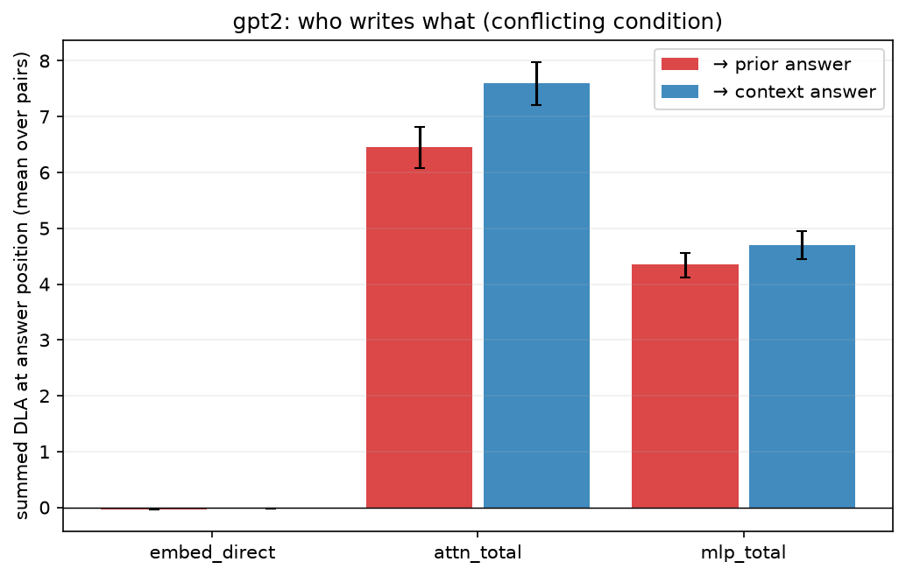
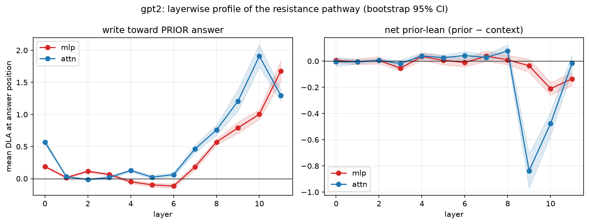
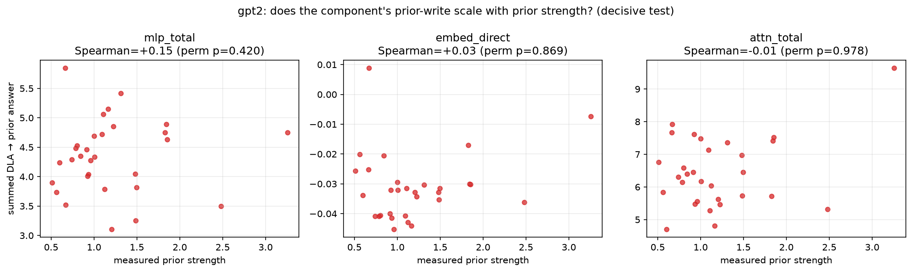
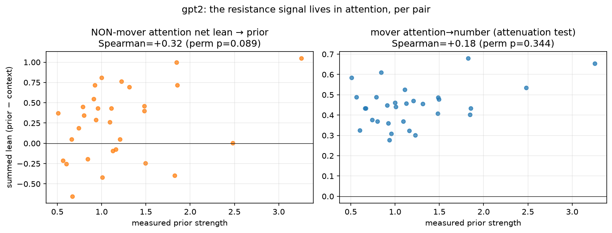
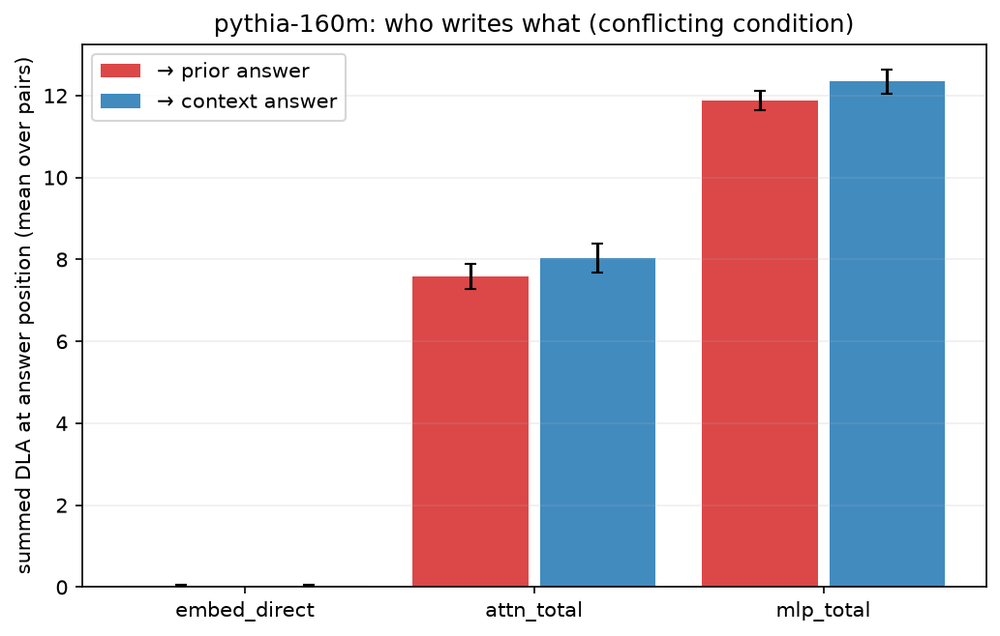
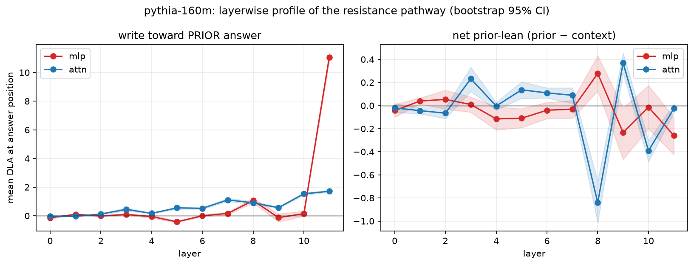
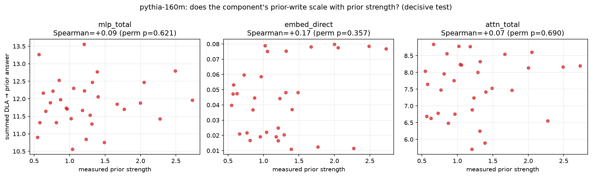
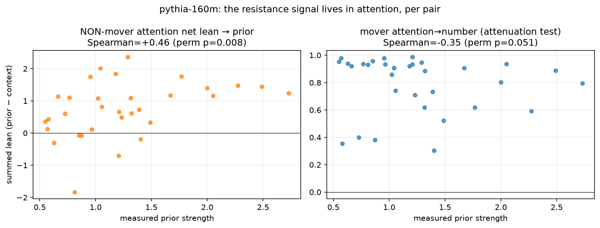

# Phase 4 Report: Where Does Parametric Resistance Live?

**Question:** Phase 3 showed no head carries the prior and attributed the resistance to the 'rest' by elimination. This phase decomposes the rest directly: embed / per-layer attention / per-layer MLP contributions to the answer-position logits, their prior-direction writes, and — the decisive test — whether those writes SCALE with the measured prior strength (the property the negative heads lacked).

Seed 0; bootstrap 5000; permutation 20000. Directions are vocab-centered unembeds (as Phase 3). Reconstruction max error: gpt2 = 4e-06, pythia-160m = 1e-05. Compute: 11.4 min (CPU).

## gpt2

### 1. Component decomposition (conflicting condition)

| class | dla_prior | dla_context | prior_lean |
| --- | --- | --- | --- |
| attn_total | 6.452 | 7.592 | -1.140 |
| embed_direct | -0.031 | -0.022 | -0.009 |
| mlp_total | 4.348 | 4.702 | -0.353 |

### 3. Layerwise MLP profile: diffuse or concentrated?

- Top-3 prior-writing MLP layers: [11, 10, 9] carrying 75% of the total positive MLP prior-write (9/12 layers positive).

### 2. The decisive test: does the prior-write scale with prior strength?

| class | quantity | spearman | perm_p | pearson | n |
| --- | --- | --- | --- | --- | --- |
| mlp_total | dla_prior | 0.152 | 0.420 | 0.036 | 30 |
| mlp_total | prior_lean | 0.280 | 0.135 | 0.270 | 30 |
| embed_direct | dla_prior | 0.031 | 0.869 | 0.187 | 30 |
| embed_direct | prior_lean | -0.254 | 0.173 | -0.032 | 30 |
| attn_total | dla_prior | -0.005 | 0.978 | 0.326 | 30 |
| attn_total | prior_lean | 0.135 | 0.481 | 0.020 | 30 |
| mlp_L11 | dla_prior | 0.157 | 0.408 | 0.080 | 30 |
| mlp_L10 | dla_prior | 0.007 | 0.970 | 0.088 | 30 |
| mlp_L9 | dla_prior | 0.143 | 0.453 | 0.117 | 30 |

Contrast (Phase 3): movers flat (ρ = +0.07 / +0.02), negative heads anti-scaling (ρ = −0.19 / −0.38).

### 1c. Where the resistance actually shows up (post-hoc, forced by the data)

Per-class net lean (prior − context), pairs where context WINS vs LOSES (n_loses = 1):

| class | wins | loses |
| --- | --- | --- |
| embed_direct | -0.008 | -0.020 |
| attn_total | -1.188 | 0.251 |
| mlp_total | -0.367 | 0.052 |

| test | spearman | perm_p | n |
| --- | --- | --- | --- |
| nonmover_attn_lean_vs_prior | 0.315 | 0.089 | 30 |
| mover_diff_dla_vs_prior | 0.243 | 0.198 | 30 |
| mover_attn_number_vs_prior | 0.180 | 0.344 | 30 |
| ld_clean_vs_prior | -0.318 | 0.086 | 30 |

### 3b. Causal check: mean-ablating the top prior-writing MLP layers

| condition | ablation | n | mean_delta_ld | ci | baseline_cf | ablated_cf |
| --- | --- | --- | --- | --- | --- | --- |
| conflicting | mlp_top3_combined | 30 | -0.455 | [-0.56,-0.37] | 0.967 | 0.800 |
| conflicting | mlp_L10 | 30 | -0.279 | [-0.32,-0.23] | 0.967 | 0.900 |
| conflicting | mlp_L11 | 30 | -0.128 | [-0.17,-0.09] | 0.967 | 0.867 |
| conflicting | mlp_L9 | 30 | -0.048 | [-0.11,0.02] | 0.967 | 0.900 |
| conflicting | ctrl_mlp_L1 | 30 | -0.006 | [-0.01,-0.00] | 0.967 | 0.967 |
| supportive | mlp_L11 | 30 | -0.077 | [-0.14,-0.02] | 1.000 | 1.000 |
| supportive | ctrl_mlp_L1 | 30 | 0.002 | [-0.00,0.01] | 1.000 | 1.000 |
| supportive | mlp_top3_combined | 30 | 0.011 | [-0.09,0.12] | 1.000 | 1.000 |
| supportive | mlp_L10 | 30 | 0.019 | [-0.04,0.08] | 1.000 | 1.000 |
| supportive | mlp_L9 | 30 | 0.030 | [-0.02,0.08] | 1.000 | 1.000 |

(Prediction if these MLPs supply resistance: ΔLD > 0 on the conflicting condition — removing them frees the context answer. The control layer should sit near 0. Interpret jointly with the fact that late-MLP ablation also removes generic next-token processing.)

## pythia-160m

### 1. Component decomposition (conflicting condition)

| class | dla_prior | dla_context | prior_lean |
| --- | --- | --- | --- |
| attn_total | 7.581 | 8.034 | -0.453 |
| embed_direct | 0.044 | 0.042 | 0.002 |
| mlp_total | 11.882 | 12.348 | -0.466 |

### 3. Layerwise MLP profile: diffuse or concentrated?

- Top-3 prior-writing MLP layers: [11, 8, 7] carrying 97% of the total positive MLP prior-write (7/12 layers positive).

### 2. The decisive test: does the prior-write scale with prior strength?

| class | quantity | spearman | perm_p | pearson | n |
| --- | --- | --- | --- | --- | --- |
| mlp_total | dla_prior | 0.090 | 0.621 | 0.102 | 32 |
| mlp_total | prior_lean | -0.054 | 0.777 | -0.021 | 32 |
| embed_direct | dla_prior | 0.169 | 0.357 | 0.300 | 32 |
| embed_direct | prior_lean | 0.281 | 0.119 | 0.436 | 32 |
| attn_total | dla_prior | 0.073 | 0.690 | 0.126 | 32 |
| attn_total | prior_lean | 0.367 | 0.041 | 0.434 | 32 |
| mlp_L11 | dla_prior | 0.116 | 0.532 | 0.321 | 32 |
| mlp_L8 | dla_prior | 0.347 | 0.050 | 0.390 | 32 |
| mlp_L7 | dla_prior | -0.302 | 0.094 | -0.338 | 32 |

Contrast (Phase 3): movers flat (ρ = +0.07 / +0.02), negative heads anti-scaling (ρ = −0.19 / −0.38).

### 1c. Where the resistance actually shows up (post-hoc, forced by the data)

Per-class net lean (prior − context), pairs where context WINS vs LOSES (n_loses = 8):

| class | wins | loses |
| --- | --- | --- |
| embed_direct | 0.001 | 0.003 |
| attn_total | -0.658 | 0.163 |
| mlp_total | -0.555 | -0.200 |

| test | spearman | perm_p | n |
| --- | --- | --- | --- |
| nonmover_attn_lean_vs_prior | 0.462 | 0.008 | 32 |
| mover_diff_dla_vs_prior | -0.049 | 0.789 | 32 |
| mover_attn_number_vs_prior | -0.346 | 0.051 | 32 |
| ld_clean_vs_prior | -0.492 | 0.004 | 32 |

### 3b. Causal check: mean-ablating the top prior-writing MLP layers

| condition | ablation | n | mean_delta_ld | ci | baseline_cf | ablated_cf |
| --- | --- | --- | --- | --- | --- | --- |
| conflicting | mlp_L11 | 32 | -0.450 | [-0.55,-0.35] | 0.750 | 0.656 |
| conflicting | mlp_top3_combined | 32 | -0.444 | [-0.56,-0.34] | 0.750 | 0.562 |
| conflicting | ctrl_mlp_L6 | 32 | -0.083 | [-0.23,0.06] | 0.750 | 0.812 |
| conflicting | mlp_L7 | 32 | -0.027 | [-0.08,0.03] | 0.750 | 0.750 |
| conflicting | mlp_L8 | 32 | 0.007 | [-0.06,0.08] | 0.750 | 0.750 |
| supportive | mlp_L8 | 32 | -0.034 | [-0.12,0.06] | 1.000 | 1.000 |
| supportive | mlp_L7 | 32 | 0.030 | [-0.03,0.10] | 1.000 | 1.000 |
| supportive | ctrl_mlp_L6 | 32 | 0.083 | [-0.03,0.20] | 1.000 | 1.000 |
| supportive | mlp_L11 | 32 | 0.248 | [0.14,0.35] | 1.000 | 1.000 |
| supportive | mlp_top3_combined | 32 | 0.260 | [0.10,0.41] | 1.000 | 1.000 |

(Prediction if these MLPs supply resistance: ΔLD > 0 on the conflicting condition — removing them frees the context answer. The control layer should sit near 0. Interpret jointly with the fact that late-MLP ablation also removes generic next-token processing.)

## Limitations
- DLA at the answer position measures *direct* writes; prior information reaching the logits via composition through later components is attributed to the final writer, not the source.
- Vocab-centered single-token projections: absolute values depend on the centering; comparisons across components and the scaling correlations do not.
- MLP-layer ablation at the final position removes the layer's whole contribution there, not just the prior-write — CF changes confound generic processing loss with resistance removal (control layer partially calibrates).
- n ≈ 30 pairs/model; one template; single-token answers.

## Critical assessment

### Verdict: the Phase 3 wording is REFUTED in its specifics and must change again. Resistance is (i) NOT MLP-side, (ii) NOT embedding-side, and (iii) not "diffuse everywhere" — it is a diffuse, prior-tracking shift WITHIN THE ATTENTION LAYER, alongside (in Pythia) attenuation of the movers' own attention to the retrieved fact. The MLPs, far from resisting, net-support the context answer. This is the third rewording of the claim, and it is the first one anchored in positive evidence rather than elimination.

Hand-written after inspecting the numbers and figures; not produced by the
analysis script. Paper writing has NOT started.

#### The three questions, answered plainly

**(i) Is the resistance MLP/residual-side? NO — refuted on three counts.**
- MLPs write *both* answers massively (Pythia mlp_total: prior +11.9, context
  +12.3 — generic number promotion) with a net lean toward **context**
  (−0.35 GPT-2, −0.47 Pythia). The task-1b prediction ("MLPs carry net-prior")
  is wrong.
- The causal check came back with the **opposite sign**: mean-ablating the top
  prior-writing MLP layers *hurts* context-following (GPT-2 top-3 combined
  ΔLD = −0.46, CF 0.97→0.80; Pythia L11 ΔLD = −0.45, CF 0.75→0.56 combined),
  while the control layer sits at ~0. Late MLPs are net context-*supporters*.
- Direct embeddings are negligible (|DLA| ≤ 0.04 both directions, both models).

**(ii) Does anything scale with prior strength? Yes — but not the MLPs.**
MLP-aggregate prior-write scaling is null (ρ = +0.15 / +0.09, p ≥ 0.42). The
scaling lives in attention:
- **Non-mover attention net lean toward the prior: Pythia ρ = +0.46
  (perm p = 0.008)** — the strongest, cleanest scaling signal found anywhere
  in this project, and it survives multiple-comparison correction within its
  test family. GPT-2 shows the same direction (ρ = +0.32, p = 0.089).
- **Mover attenuation (Pythia): ρ = −0.35 (p = 0.051)** — on strong-prior
  pairs the mover heads attend the retrieved number *less*. Resistance
  partly operates by weakening the context pathway, not only by opposing it.
- These jointly mirror the behavioral gradient they must explain
  (LD_clean vs prior: ρ = −0.49 / −0.32).

**(iii) Diffuse or concentrated? Diffuse — but specifically within attention.**
On pairs where context loses, the class whose net lean flips to the prior side
is attention (GPT-2: −1.19 → +0.25; Pythia: −0.66 → +0.16, ~70–75% of the
wins→loses shift), while MLPs *stay context-leaning* even there. Yet Phase 3's
global scan showed no single head with prior-lean above +0.14. Both are true
simultaneously: the prior-side attention signal is spread across many
sub-threshold heads whose aggregate tracks prior strength. "No memory heads,
but a memory *tide* in the attention layer."

#### Reconciling all four phases into one mechanism story

1. Context answer: read and written by 2–3 sparse, prior-invariant mover heads
   (Phases 1–3).
2. Parametric answer: NOT written by any dedicated head (Phase 3 scan), NOT
   net-written by MLPs at the answer position (this phase). It enters as a
   diffuse, prior-strength-tracking lean across the rest of the attention
   layer, plus attenuation of the movers themselves (Pythia).
3. Late MLPs amplify the running consensus (they causally support whichever
   answer is winning — ablating them hurt context on pairs where context was
   winning); they are shared infrastructure, not a memory pathway.
4. Storage vs transport: none of this says facts aren't *stored* in MLPs
   (ROME-style, at subject positions). Our DLA measures the final *transport*
   into the answer logits — and that transport is attention, in both
   directions. The paper must keep this distinction explicit.

#### What was wrong before, said clearly

- Phase 3's "resistance is diffuse and MLP/residual-side" was inference by
  elimination, and its MLP clause was **wrong**. The residual/'rest' term was
  dominated by *non-mover attention*, which Phase 3 never split out.
- The Phase 4 task's own predictions (1b: MLP net-prior; 3b: MLP ablation
  frees context) were both refuted. The positive finding (attention-side
  resistance) came from a **post-hoc** analysis forced by the data — it is
  labeled exploratory in the report and should be treated as the primary
  target for any future confirmation, ideally on a fresh pair set.

#### Limitations that bound this phase

- The attention-side result is post-hoc (predictions failed first); n ≈ 30;
  GPT-2 contributes only 1 context-loses pair, so the wins/loses flip rests on
  Pythia (n = 8). GPT-2's evidence is directional consistency, not
  significance.
- DLA attributes to the final writer; attention "carrying" the prior at the
  answer position is compatible with MLP storage upstream.
- Non-mover attention lean is an aggregate of ~141 heads; we did not identify
  which subsets contribute, beyond knowing (Phase 3) that no single head
  dominates.
- Single template, single-token answers, two small models — as throughout.

#### Final claim wording for the paper (pending sign-off)

> In small transformers, faithfulness to retrieved context is carried by a
> sparse, prior-invariant circuit of attention mover heads. Resistance from
> parametric memory is not localized in any component class we can name a
> head or layer for: it is a diffuse, prior-strength-tracking lean across the
> rest of the attention layer — with no counterpart to the billion-scale
> "memory heads" of Jin et al. — plus a measurable attenuation of the mover
> heads' own attention on strongly-held facts. MLPs act as shared
> amplification, net-supporting whichever answer is winning. The conflict is
> resolved in the residual stream at the answer position, between a localized
> context pathway and a distributed attention-side memory tide.

Every clause traces to a number in phases 1–4. The wording concedes what we
could not localize, which is the honest shape of the result.

#### If further work is authorized before the paper (logged, not started)

1. Confirmatory test of the attention-tide scaling on a fresh templated pair
   set (pre-registered direction, one test, no correction debt).
2. Rank the non-mover heads by per-pair prior-lean covariance to see whether
   the "tide" is 20 heads or 100 (cheap, cached activations suffice).
3. Then the paper.
