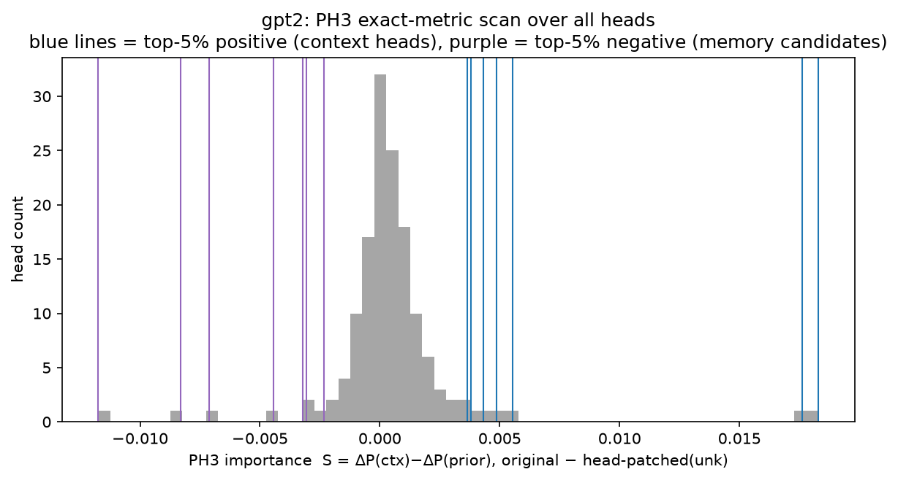
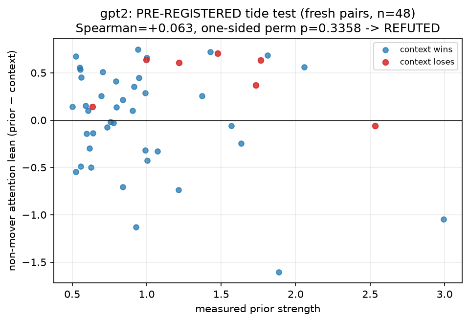
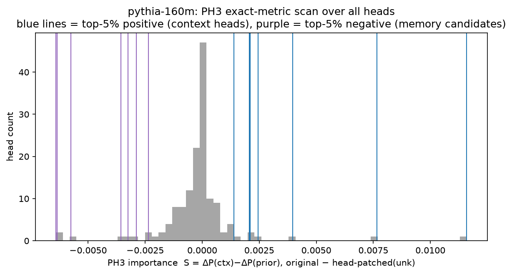
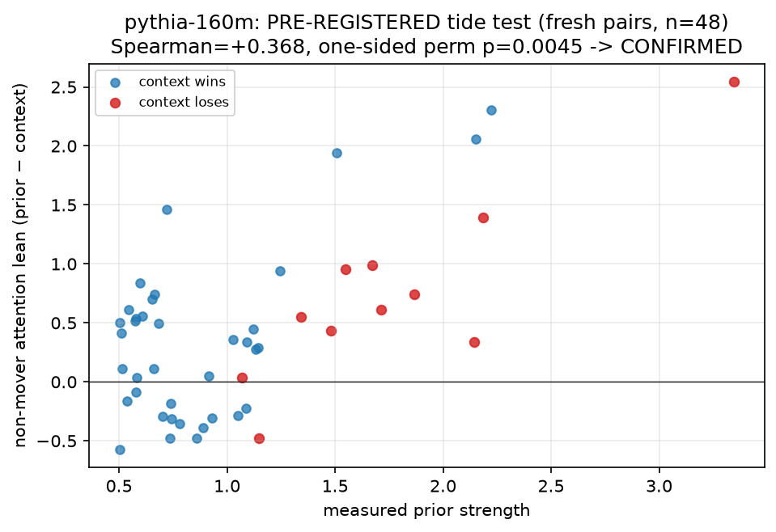

# Phase 5 Report: PH3 Metric Match + Pre-registered Tide Test

**(A)** Does the memory-head region stay empty under Jin et al. 2024's OWN importance metric (locks the scale-boundary headline)? **(B)** Does the Phase 4 attention-tide correlation survive a pre-registered test on fresh, fact-disjoint pairs?

- Pre-registration frozen at commit `539355a564c1` (git first-add commit verified: `539355a564c1`), BEFORE any fresh pair existed.
- Fresh-set provenance: 103 candidates generated after the freeze; one disclosed expansion round to 149 was added because the prior-filter stage alone under-shot the pre-registered 40-pair floor (GPT-2: 38) — the expansion was decided on attrition counts only, before any tide or behavioral (LD) value was measured. All facts are disjoint from Phases 0–4.
- gpt2: 149 generated → 147 tokenization-passed → 48 prior-passed → 48 after the denominator gate; context-loses n = 7.
- pythia-160m: 149 generated → 147 tokenization-passed → 54 prior-passed → 48 after the denominator gate; context-loses n = 11.
- PH3 metric reconstruction: corrupted input = critical number replaced by the EOS token (neither tokenizer has a true <unk>; documented substitution); S = [P(ctx)−P(prior)]_original − [P(ctx)−P(prior)]_head-patched, probability space, head z patched at all positions; top-5% each sign classified per PH3.
- Seed 0; compute 17.1 min (CPU).

## gpt2

### (A) PH3 exact-metric scan

Top-5% most NEGATIVE (candidate memory heads, n=7):

| unit | ph3_importance |
| --- | --- |
| L10H7 | -0.012 |
| L0H10 | -0.008 |
| L8H10 | -0.007 |
| L7H6 | -0.004 |
| L4H8 | -0.003 |
| L9H5 | -0.003 |
| L8H2 | -0.002 |

Top-5% most POSITIVE (context heads):

| unit | ph3_importance |
| --- | --- |
| L5H10 | 0.004 |
| L8H11 | 0.004 |
| L0H9 | 0.004 |
| L5H5 | 0.005 |
| L6H2 | 0.006 |
| L9H9 | 0.018 |
| L10H2 | 0.018 |

- Asymmetry: strongest context-head importance +0.0183 vs strongest memory-candidate -0.0117 (|context|/|memory| = 1.6×).
- Our movers inside PH3's context-head top-5%: ['L9H9', 'L10H2']; our negative heads inside PH3's memory top-5%: ['L10H7'].

### (B) Pre-registered tide test — frozen verdicts

- **PRIMARY (H1): REFUTED** — Spearman = +0.063 (threshold ≥ +0.30), one-sided perm p = 0.3358 (criterion < 0.05), n = 48 (floor 40).
- **SECONDARY (H2): INVALID (n_loses < 20 floor)** (n_loses = 7, floor 20).

## pythia-160m

### (A) PH3 exact-metric scan

Top-5% most NEGATIVE (candidate memory heads, n=7):

| unit | ph3_importance |
| --- | --- |
| L9H1 | -0.006 |
| L9H5 | -0.006 |
| L3H10 | -0.006 |
| L2H8 | -0.004 |
| L0H11 | -0.003 |
| L6H7 | -0.003 |
| L3H6 | -0.002 |

Top-5% most POSITIVE (context heads):

| unit | ph3_importance |
| --- | --- |
| L1H8 | 0.001 |
| L0H2 | 0.002 |
| L4H11 | 0.002 |
| L10H3 | 0.002 |
| L8H2 | 0.004 |
| L10H7 | 0.008 |
| L8H10 | 0.012 |

- Asymmetry: strongest context-head importance +0.0116 vs strongest memory-candidate -0.0064 (|context|/|memory| = 1.8×).
- Our movers inside PH3's context-head top-5%: ['L8H10', 'L10H7', 'L8H2']; our negative heads inside PH3's memory top-5%: ['L9H1', 'L9H5'].

### (B) Pre-registered tide test — frozen verdicts

- **PRIMARY (H1): CONFIRMED** — Spearman = +0.368 (threshold ≥ +0.30), one-sided perm p = 0.0045 (criterion < 0.05), n = 48 (floor 40).
- **SECONDARY (H2): INVALID (n_loses < 20 floor)** (n_loses = 11, floor 20).

## Exploratory (NOT pre-registered; cannot change the verdicts above)

- gpt2: mean non-mover lean on context-loses pairs +0.435 (n=7) vs wins +0.003 (n=41); behavioral gradient Spearman(LD_clean, prior) = -0.469.
- pythia-160m: mean non-mover lean on context-loses pairs +0.738 (n=11) vs wins +0.338 (n=37); behavioral gradient Spearman(LD_clean, prior) = -0.553.

## Limitations
- PH3 metric is a reconstruction from the paper's method description (their Eq. 12 uses paired context/memory datasets; we compute the single-dataset version on our conflicting pairs). EOS stands in for <unk>. Their smallest model is ~8× our largest — the comparison bounds the motif's emergence, it does not re-run their exact code.
- Fresh-set expansion round disclosed above; decided on attrition counts only.
- The tide statistic aggregates ~141 heads; per-head structure not tested here.

## Critical assessment

### Verdict — (A) the scale boundary SHARPENS rather than simply "locks": PH3's own metric does flag a weak memory side at our scale, but the flagged heads are exactly the ones we already proved are NOT prior-writers. (B) The attention tide survived pre-registration in Pythia-160M (CONFIRMED, ρ = +0.37, p = 0.0045, n = 48 fresh pairs) and FAILED in GPT-2-small (REFUTED, ρ = +0.06). The paper reports a metric-robust mover circuit, a mechanism-tested absence of functional memory heads, and a model-split, pre-registered tide.

Hand-written after inspecting the numbers; not produced by the analysis
script. Pre-registration frozen at commit 539355a before any fresh pair
existed; the expansion round (103→149 candidates) was decided on attrition
counts alone, before any tide or behavioral value was measured, and is
disclosed in the report.

#### (A) PH3 exact-metric match — what locks, what changes

Reimplementing Jin et al.'s importance score (unk-corrupted head patching on
P(ctx)−P(mem); EOS as the <unk> stand-in) on our pairs:

- **The context side is metric-robust.** Our movers are PH3's top context
  heads under THEIR metric in BOTH models (GPT-2: L9H9 +0.0176, L10H2 +0.0183
  — ranks 1–2 of 144; Pythia: L8H10 +0.0116, L10H7 +0.0077, L8H2 +0.0040 —
  ranks 1–3). Two unrelated localization metrics, same circuit. Locked.
- **The "empty memory-head region" phrasing does NOT survive their metric —
  and the replacement is stronger.** PH3's top-5% negative (memory-side)
  candidates are led, in both models, by precisely our negative heads
  (GPT-2 L10H7 −0.0117 at rank 1; Pythia L9H1/L9H5 −0.0064 at ranks 1–2).
  So their metric, at our scale, does produce a "memory head" list. But
  Phase 3 already established mechanistically that these heads write against
  BOTH answers (never toward the prior), anti-scale with prior strength, and
  lose their effect when the movers are ablated. **Importance-score memory
  heads are not functional memory heads.** The corrected claim: at 124M–160M
  there are no heads with the memory-head FUNCTION (write the prior, scale
  with it); what PH3's score flags at this scale are reactive context-dampeners
  — a caution for interpreting PH3-style scores generally.
- Asymmetry under their metric: strongest context head 1.6–1.8× the strongest
  memory candidate (vs 6–10× under our directional-DLA metric). The boundary
  claim survives in functional terms, not as an empty region on every metric.
- Caveats: our reconstruction (single-dataset version of their Eq. 12; EOS
  stand-in) is faithful to their description but is not their code; and the
  probability-space magnitudes here (|S| ≤ 0.012) are not directly comparable
  to their pruning outcomes at 1.3B+.

#### (B) The pre-registered tide test — frozen verdicts, reported as-is

| model | primary H1 (ρ ≥ 0.30, one-sided p < .05) | secondary H2 |
|---|---|---|
| Pythia-160M | **CONFIRMED**: ρ = +0.368, p = 0.0045, n = 48 | INVALID (n_loses = 11 < 20) |
| GPT-2-small | **REFUTED**: ρ = +0.063, p = 0.336, n = 48 | INVALID (n_loses = 7 < 20) |

- **Pythia's tide is now a finding**, not an exploration: predicted direction,
  frozen threshold, disjoint data, near the Phase 4 magnitude (0.46 → 0.37).
- **GPT-2's tide did not replicate.** Phase 4's +0.32 (p = 0.089) fell to
  +0.06 on fresh pairs — the frozen rule says REFUTED and that is what the
  paper says. Exploratory context (cannot change the verdict): GPT-2's
  resistance regime barely exists — 7/48 fresh context-loses pairs vs
  Pythia's 11, and 1/30 in Phase 4 — so range restriction plausibly
  contributes; but a hypothesis that only detects its effect where the
  regime is thick is, for GPT-2, an unsupported hypothesis.
- **Both secondaries are validity failures, disclosed:** even a 149-candidate
  battery skewed toward entrenched facts produced only 7–11 context-loses
  pairs per model. That is itself a finding worth one line in the paper:
  under this format, small models overwhelmingly follow context; genuine
  resistance is the rare regime.

#### What the paper now says (final wording, pending sign-off)

1. **Mover circuit (both models, metric-robust, five phases of convergent
   evidence):** faithfulness to retrieved context is carried by 2–3 late
   attention heads that read the retrieved fact and write it into the answer;
   prior-invariant; validated by patching, ablation, attribution, and PH3's
   own importance metric.
2. **No functional memory heads at 124M–160M:** no head writes the parametric
   answer or scales with prior strength. Heads that PH3-style importance
   scores flag as "memory heads" at this scale are, mechanistically, reactive
   context-dampeners — the billion-scale memory-head motif has no functional
   counterpart here, and importance scores alone can mislabel it.
3. **Resistance (model-split, stated at exactly the earned confidence):** in
   Pythia-160M, a pre-registered, replicated finding — parametric resistance
   appears as a diffuse, prior-strength-tracking lean across the non-mover
   attention layer (the "tide"). In GPT-2-small the tide failed pre-registered
   replication and is reported as not established; GPT-2's resistance regime
   is thin under this task format. MLPs, in both models, net-amplify the
   winning answer rather than carrying the prior.
4. Everything else (negation null, copy-controls, selection effects, all
   reworded claims across phases) goes in as documented limitations and
   negative results.

#### Standing limitations

- One prompt format, single-token numeric answers, two models, n ≤ 54/model.
- PH3 comparison is a reconstruction, not a code-level replication.
- The tide is an aggregate over ~141 heads; its internal structure (how many
  heads, which depths) remains uncharacterized.
- Secondaries never ran: the context-loses regime could not be populated to
  the pre-registered floor at this scale.

This was the last analysis phase. The paper proceeds on sign-off, with the
claims above at the stated confidence levels.
