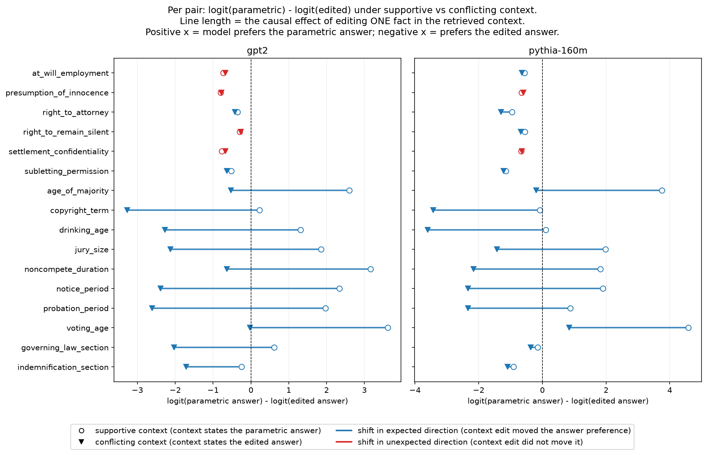

# Phase 0 Pilot Report: Is Context-vs-Parametric Conflict Measurable?

**Question this experiment answers:** at GPT-2-small / Pythia-160M scale, does editing a single fact in retrieved legal context (supportive -> conflicting) produce a measurable, consistent shift in the model's next-token preference between the context-stated answer and the alternative? This is the VALIDATION-FIRST gate from CLAUDE.md: Phase 1 (activation patching / attribution / ablation) does not start until a human signs off on this verdict.

- Models: gpt2, pythia-160m (via TransformerLens, CPU)
- Pairs: 16 hand-written minimal pairs (data\pairs\pairs.jsonl)
- Seed: 0 (python/numpy/torch; forward passes over a frozen model in eval mode are deterministic, so this is a reproducibility log, not a variance control)
- Metric: logit(parametric_answer token) - logit(edited_answer token), read off the final-position next-token logits after the prompt's trailing "Answer:"

## Method

Each pair has one legal question and two versions of retrieved context differing by a single controlled edit (a number swapped, or a clause negated). `parametric_answer` is the value we hypothesized the model's pretraining-era prior favors; `context_supportive` states that value; `context_conflicting` states `edited_answer` instead. A third `neutral` condition (question alone, no context block) probes the model's bare prior between the two candidate tokens, to check whether the `parametric_answer` hypothesis is actually correct for each pair rather than just asserted.

`shift_conflicting_minus_supportive` = raw_diff(conflicting) - raw_diff(supportive). If the context edit has any causal effect on the model's answer, this should be reliably **negative** (conflicting context pulls preference away from the parametric answer, toward the edited one). A value near zero means the edit did not move the model's preference at all.

## Per-model summary

### gpt2

- Mean shift: -2.189 (median -2.885, std 1.901)
- 12/16 pairs (75%) shifted in the expected direction (sign test p=0.0768)
- Restricting to the 9 pairs hypothesized to have a real parametric prior: 7/9 (78%) shifted in the expected direction
- Prior-check: the neutral (no-context) condition actually favored the hypothesized `parametric_answer` in 4/9 (44%) of strong-prior pairs -- this validates (or not) our own labeling, it is not the pass/fail criterion for the pilot

By edit type:

| edit_type | n | mean shift | median shift | expected direction | sign test p |
| --- | --- | --- | --- | --- | --- |
| negation | 6 | 0.003 | 0.022 | 2/6 | 0.6875 |
| numeric_swap | 8 | -3.867 | -3.720 | 8/8 | 0.0078 |
| section_number | 2 | -2.055 | -2.055 | 2/2 | 0.5000 |

### pythia-160m

- Mean shift: -1.908 (median -1.779, std 1.865)
- 14/16 pairs (88%) shifted in the expected direction (sign test p=0.0042)
- Restricting to the 9 pairs hypothesized to have a real parametric prior: 8/9 (89%) shifted in the expected direction
- Prior-check: the neutral (no-context) condition actually favored the hypothesized `parametric_answer` in 3/9 (33%) of strong-prior pairs -- this validates (or not) our own labeling, it is not the pass/fail criterion for the pilot

By edit type:

| edit_type | n | mean shift | median shift | expected direction | sign test p |
| --- | --- | --- | --- | --- | --- |
| negation | 6 | -0.092 | -0.081 | 4/6 | 0.6875 |
| numeric_swap | 8 | -3.696 | -3.725 | 8/8 | 0.0078 |
| section_number | 2 | -0.201 | -0.201 | 2/2 | 0.5000 |

## Plot

## Full per-pair, per-model results

| model_name | pair_id | edit_type | has_strong_prior | raw_diff_neutral | raw_diff_supportive | raw_diff_conflicting | shift_conflicting_minus_supportive |
| --- | --- | --- | --- | --- | --- | --- | --- |
| gpt2 | at_will_employment | negation | False | -0.412 | -0.735 | -0.672 | 0.062 |
| gpt2 | presumption_of_innocence | negation | True | -0.590 | -0.799 | -0.784 | 0.015 |
| gpt2 | right_to_attorney | negation | True | -0.019 | -0.356 | -0.421 | -0.065 |
| gpt2 | right_to_remain_silent | negation | True | -0.076 | -0.292 | -0.262 | 0.030 |
| gpt2 | settlement_confidentiality | negation | False | -0.009 | -0.767 | -0.674 | 0.093 |
| gpt2 | subletting_permission | negation | False | -0.118 | -0.523 | -0.638 | -0.114 |
| gpt2 | age_of_majority | numeric_swap | True | 1.482 | 2.600 | -0.528 | -3.128 |
| gpt2 | copyright_term | numeric_swap | True | -1.484 | 0.229 | -3.273 | -3.502 |
| gpt2 | drinking_age | numeric_swap | True | -1.006 | 1.314 | -2.270 | -3.584 |
| gpt2 | jury_size | numeric_swap | True | 0.270 | 1.854 | -2.124 | -3.978 |
| gpt2 | noncompete_duration | numeric_swap | False | 1.569 | 3.158 | -0.633 | -3.791 |
| gpt2 | notice_period | numeric_swap | True | 0.085 | 2.341 | -2.390 | -4.731 |
| gpt2 | probation_period | numeric_swap | False | -0.787 | 1.967 | -2.608 | -4.575 |
| gpt2 | voting_age | numeric_swap | True | 1.844 | 3.620 | -0.028 | -3.648 |
| gpt2 | governing_law_section | section_number | False | -0.870 | 0.611 | -2.031 | -2.642 |
| gpt2 | indemnification_section | section_number | False | -0.688 | -0.243 | -1.711 | -1.467 |
| pythia-160m | at_will_employment | negation | False | -0.629 | -0.557 | -0.646 | -0.089 |
| pythia-160m | presumption_of_innocence | negation | True | -0.646 | -0.658 | -0.591 | 0.066 |
| pythia-160m | right_to_attorney | negation | True | -0.648 | -0.947 | -1.295 | -0.347 |
| pythia-160m | right_to_remain_silent | negation | True | -0.453 | -0.546 | -0.676 | -0.131 |
| pythia-160m | settlement_confidentiality | negation | False | -0.253 | -0.669 | -0.647 | 0.022 |
| pythia-160m | subletting_permission | negation | False | -0.929 | -1.147 | -1.220 | -0.073 |
| pythia-160m | age_of_majority | numeric_swap | True | 1.999 | 3.749 | -0.193 | -3.942 |
| pythia-160m | copyright_term | numeric_swap | True | -1.768 | -0.083 | -3.427 | -3.344 |
| pythia-160m | drinking_age | numeric_swap | True | -2.051 | 0.101 | -3.600 | -3.701 |
| pythia-160m | jury_size | numeric_swap | True | 0.361 | 1.979 | -1.430 | -3.409 |
| pythia-160m | noncompete_duration | numeric_swap | False | 0.934 | 1.818 | -2.160 | -3.978 |
| pythia-160m | notice_period | numeric_swap | True | -0.482 | 1.904 | -2.333 | -4.237 |
| pythia-160m | probation_period | numeric_swap | False | -1.289 | 0.875 | -2.336 | -3.210 |
| pythia-160m | voting_age | numeric_swap | True | 2.730 | 4.587 | 0.839 | -3.748 |
| pythia-160m | governing_law_section | section_number | False | -0.813 | -0.150 | -0.366 | -0.216 |
| pythia-160m | indemnification_section | section_number | False | -1.036 | -0.907 | -1.093 | -0.186 |

## Critical assessment

### Verdict: YES — context-vs-parametric conflict is measurable at this scale, but only for numeric-fact edits. The negation pairs produced no signal and are unusable as designed.

Phase 1 is justified on a **scoped-down design (numeric swaps only)**, pending human
sign-off per CLAUDE.md's VALIDATION-FIRST rule. Nothing below has been built yet.

#### What the data shows

1. **Numeric swaps (8 pairs/model): decisive.** Every pair shifted in the expected
   direction in both models (8/8, sign-test p = 0.0078 — the floor for n = 8). Mean
   shift: −3.87 logits (GPT-2), −3.70 (Pythia-160M). A single-number edit in the
   context moves the answer preference by ~4 logits.

2. **It is genuine conflict, not just copying.** Two observations:
   - *Residual prior drag:* across the 8 numeric pairs, the correlation between the
     measured bare prior (`raw_diff_neutral`) and the preference remaining under
     conflicting context (`raw_diff_conflicting`) is r ≈ 0.95 in both models
     (Pearson 0.954 / 0.945; Spearman 0.905 / 0.976). If the models simply copied
     whatever number the context supplied, the conflicting-condition values would sit
     at a uniform negative level regardless of prior; instead they track the prior
     almost monotonically.
   - *Failed overrides where the prior is strongest:* Pythia `voting_age` still
     prefers the parametric answer **despite** conflicting context
     (raw_diff_conflicting = +0.84: context says 21, model still says 18); GPT-2
     `voting_age` is a dead heat (−0.03); `age_of_majority` lands near zero in both
     models. The tug-of-war exists, and its balance point varies with prior
     strength — exactly the phenomenon Phase 1 aims to localize.

3. **Negation (6 pairs/model): no signal.** Mean |shift| = 0.06 (GPT-2) / 0.12
   (Pythia), max 0.35, several pairs wrong-signed — 10–40× smaller than the numeric
   effects and indistinguishable from noise (sign-test p = 0.69 both models).
   Worse, logit(Yes) − logit(No) is negative in *every* condition for *every*
   negation pair in *both* models — a uniform "No" bias suggesting the Yes/No
   readout is dominated by token-level preferences, layered on top of small models'
   well-known insensitivity to negation. Two confounded problems; unusable as designed.

4. **Section numbers (2 pairs): directionally right, underpowered.** Both shifted as
   expected in both models, but with n = 2 (p = 0.5) and a large asymmetry (GPT-2
   −2.06 vs Pythia −0.20) they support no conclusion. Retain as copy-fidelity
   controls only.

5. **Our prior labels were wrong about half the time.** The neutral (no-context)
   probe favored the hypothesized `parametric_answer` in only 4/9 (GPT-2) and 3/9
   (Pythia) of the pairs we marked `has_strong_prior=True` — e.g. GPT-2's bare
   preference for the drinking-age question is 18, not 21. Parametric direction must
   be *measured per model*, not assumed from world knowledge.

#### Honest caveats

- n = 8 usable pairs — sufficient for a go/no-go gate, not for any published claim.
- Single prompt template; no paraphrase/format robustness checks yet.
- The neutral probe changes the prompt format (drops the Context block), so it is an
  imperfect prior measurement.
- The two-candidate logit diff ignores the rest of the vocabulary; the model's actual
  argmax token may be neither candidate.
- The supportive-vs-conflicting shift alone cannot distinguish *semantic integration
  of evidence* from *shallow copying of any nearby number*. This does not block
  Phase 1 — either mechanism is a context-driven signal to trace, and separating them
  is precisely what activation patching and attention analysis are for — but the
  "trusts retrieved evidence" interpretation must wait for that evidence.

#### Recommended Phase 1 scope (pending human sign-off)

- **Proceed with `numeric_swap` pairs only.** Of CLAUDE.md's mitigation menu
  (facts-the-model-knows / in-context priming / fine-tune), the data selects
  **facts-the-model-knows**: anchor each pair's parametric direction on the measured
  neutral logit-diff *per model*, and prefer facts with large |neutral| (the
  `voting_age` / `age_of_majority` class) so a real conflict exists. No fine-tuning
  or priming is needed — the numeric signal is already large.
- Expand from 8 to ~30–50 numeric pairs by templating the validated schemas
  (swap values/entity names) — for patching statistics, **not** as a benchmark
  contribution.
- Drop negation pairs from Phase 1 (redesign idea logged in IDEAS.md).
- Keep the two `section_number` pairs as copy-fidelity controls.
- Practicality confirmed: the full 96-forward-pass grid ran in ~1 minute on CPU, so
  per-pair activation patching at GPT-2-small scale is comfortably feasible.
